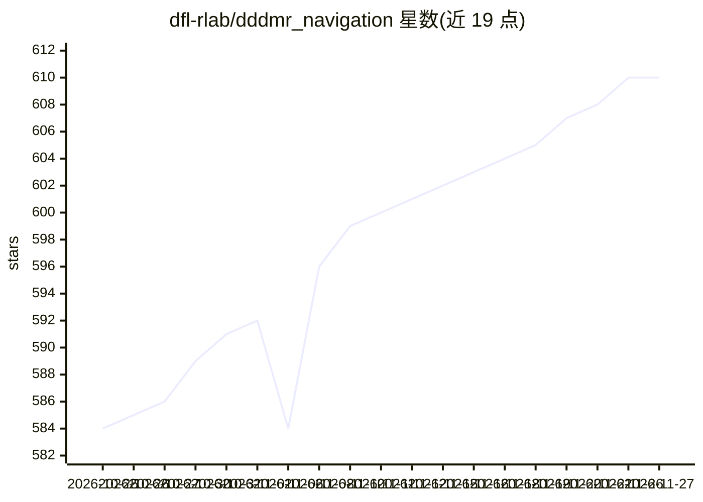

# dfl-rlab/dddmr_navigation

⭐ 610 · C++ · BSD-3-Clause · 推送 2026-11-26 · [GitHub](https://github.com/dfl-rlab/dddmr_navigation) · 组织维护

**面向移动机器人与四足机器人的完整 3D 导航栈**

dddmr_navigation 提供 3D 建图、定位、感知、路径规划、控制器与导航栈的端到端方案，面向多层建筑、坡道、楼梯等 3D 环境，支持轮式与足式机器人。README 展示四足机器人在 Gazebo 与 RViz 中跨楼层与楼梯自主导航，感知层使用 YOLO + TensorRT 做楼梯分割实时推理。README 自述目标是处理多层建图定位、立体结构 3D 路径规划与 3D 点云地图中的动态感知标记。提供引用条目（@software 引用格式），可见部分未给出安装命令。

## 筛选速览

| 维度 | 判定 | 备注 |
|---|---|---|
| AI 角色 | `ai-enhanced` | 去掉 AI 部分产品仍成立 |
| 许可风险 | `permissive` | BSD-3-Clause |
| 部署形态 | `None` |  |
| 模型依赖 | — | README 未给出锁定关系 |
| 硬件要求 | — | 无带数字的原话,不猜 |
| 安装摩擦 | `low` | 无编译、无系统依赖或容器化 |
| 成熟度 | — | 结构信号不足 |

## 能力要点

- 覆盖 mapping/localization/perception/path planning/controller/navigation stack 的完整导航栈
- YOLO + TensorRT 实时楼梯分割（README 展示）
- 多层楼层建图与定位、坡道与楼梯通行
- Gazebo 与 RViz 仿真演示

## 适用场景

- 让四足机器人在多层建筑中跨楼层与楼梯自主导航
- 为轮式/足式机器人搭建 3D 建图定位与路径规划栈
- 在 Gazebo/RViz 中复现楼梯导航演示

## 场景标签

 · 领域:机器人/自主导航

## 证据(README 行号)

> L7:  Quadruped robot navigating across multiple floors and stairs in Gazebo & RViz with real-time YOLO + TensorRT stair 
> L9: **`dddmr_navigation`** (3D Mobile Robot Navigation) is a complete, end-to-end 3D navigation stack engineered to conq

## 星数曲线

2026-10-25 584 → 2026-11-27 610（+26）

---
*卡片 v1 · prompt 1.4 · 生成 2026-11-25 · 置信度 mid · 依据 README sha `1652f350898c` · [字段定义](../../DATASET.md)*
