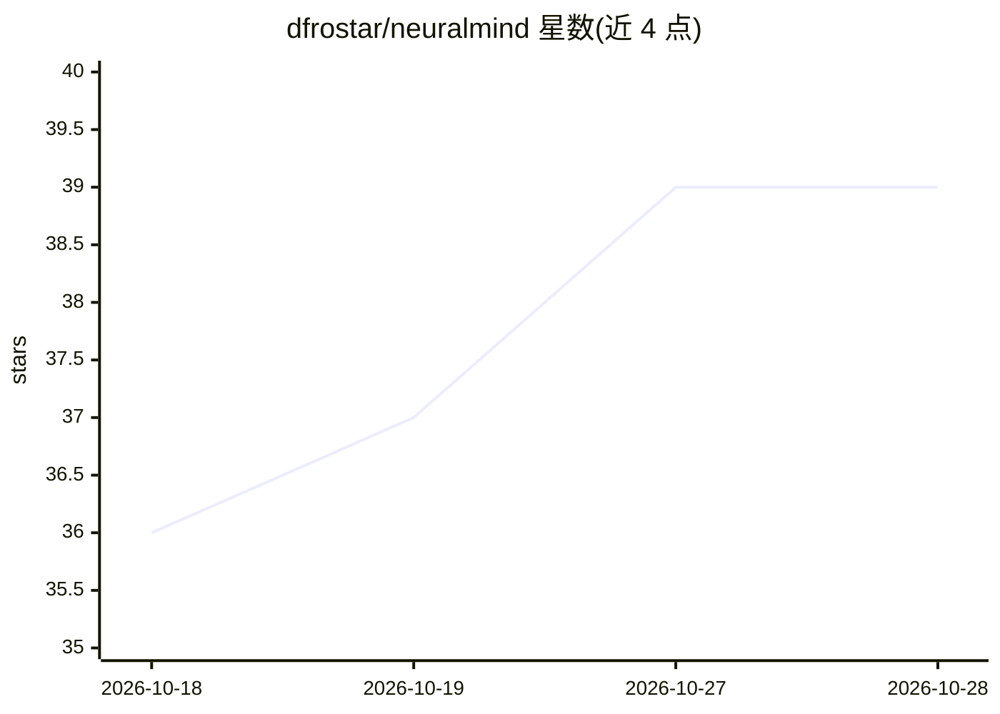

# dfrostar/neuralmind

⭐ 39 · Python · NOASSERTION · 推送 2026-10-28 · [GitHub](https://github.com/dfrostar/neuralmind) · [官网](https://dfrostar.github.io/neuralmind/) · 个人维护

**给 AI 编程 agent 的本地代码库持久记忆层**

为 Claude Code、Cursor、Cline、Continue 等 MCP 客户端提供跨会话的代码库记忆：构建 synapse 知识图谱，学习文件关联与编辑序列，在每次提示时注入数百 token 的排序上下文（含文件、行号与代码片段，自动脱敏密钥）。采用六种源自记忆研究的突触学习规则与意图感知排序，本地运行、默认无遥测。另有审计日志/校验链、SIEM 转发、SP 800-53 合规配置等功能。以 PyPI 包提供，需 Python 3.10+；Intel macOS/Windows ARM 上安装部分依赖需 Rust 工具链编译。

## 筛选速览

| 维度 | 判定 | 备注 |
|---|---|---|
| AI 角色 | `ai-ecosystem` | LLM/agent 周边工具 |
| 许可风险 | `permissive` | NOASSERTION |
| 部署形态 | `self-host` | docker 或自建部署 |
| 模型依赖 | — | README 未给出锁定关系 |
| 硬件要求 | — | 无带数字的原话,不猜 |
| 安装摩擦 | `low` | 无编译、无系统依赖或容器化 |
| 成熟度 | — | 结构信号不足 |

## 能力要点

- synapse 图谱学习文件关联与编辑序列，跨会话持久
- 每次提示注入数百 token 排序上下文（含行号、密钥脱敏）
- 六种突触学习规则与意图感知排序
- 本地优先、默认无遥测；审计日志哈希链与 syslog 转发

## 适用场景

- 让编程 agent 记住我的代码库结构，减少全文件粘贴的 token 开销
- 跨会话保留代码库上下文，不用每次重新解释项目
- 在合规要求下审计 agent 的代码库访问记录

## 场景标签

`Agent 记忆` · 领域:Agent 开发

## 证据(README 行号)

> L12: **Persistent codebase memory for AI coding agents — Claude Code, Codex, Cursor, Cline, Continue, and any MCP client
> L25: > - Recalls related files for each prompt you send (Claude Code `UserPromptSubmit` hook; on Hermes-Agent, the plugi

## 星数曲线

2026-10-18 36 → 2026-10-28 39（+3）

---
*卡片 v1 · prompt 1.4 · 生成 2026-10-25 · 置信度 mid · 依据 README sha `f9ee01d11b24` · [字段定义](../../DATASET.md)*
