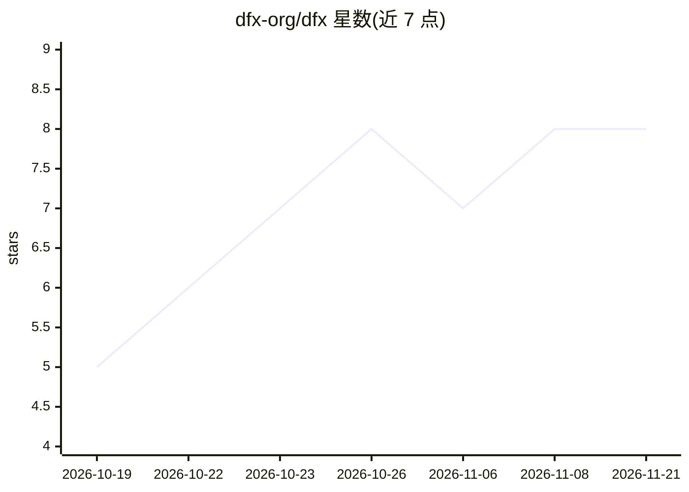

# dfx-org/dfx

⭐ 8 · F# · BSD-2-Clause · 推送 2026-11-17 · [GitHub](https://github.com/dfx-org/dfx) · [官网](https://docs.dfx.ac/) · 组织维护

**F# 可微编程张量库，面向机器学习与优化**

dfx 是 DiffSharp 的延续项目，一个支持可微编程的 F# 张量库，应用于机器学习、概率编程与优化等领域。核心能力包括嵌套与混合模式微分、常用优化器、可微概率分布；命名与惯用法对齐 PyTorch，底层使用 LibTorch CUDA/C++ 张量并支持 GPU。README 注明当前分支为开发分支，代码与功能不完整且可能变更；安装信息在 docs.dfx.ac 文档站点提供，README 内未给出直接安装命令。

## 筛选速览

| 维度 | 判定 | 备注 |
|---|---|---|
| AI 角色 | `ai-native` | 本体是模型或模型工具 |
| 许可风险 | `permissive` | BSD-2-Clause |
| 部署形态 | `None` |  |
| 模型依赖 | — | README 未给出锁定关系 |
| 硬件要求 | — | 无带数字的原话,不猜 |
| 安装摩擦 | `medium` | 含编译或系统依赖之一 |
| 成熟度 | `idea` | |

## 能力要点

- 嵌套与混合模式微分
- 常用优化器、模型组件与可微概率分布
- PyTorch 风格命名，基于 LibTorch 的 GPU 张量支持
- 支持 Linux、macOS、Windows 及 Jupyter/VS Code 交互式笔记本

## 适用场景

- 在 F# 中进行机器学习模型开发
- 概率编程与优化问题的可微编程实现
- 通过 Jupyter/VS Code 交互式笔记本进行实验

## 场景标签

 · 领域:机器学习/数值计算库

## 证据(README 行号)

> L16: dfx is a tensor library with support for differentiable programming. It is designed for use in machine learning, pr
> L23: * PyTorch familiar naming and idioms, efficient LibTorch CUDA/C++ tensors with GPU support

## 星数曲线

2026-10-19 5 → 2026-11-21 8（+3）

---
*卡片 v1 · prompt 1.4 · 生成 2026-11-20 · 置信度 high · 依据 README sha `fe17ede4621b` · [字段定义](../../DATASET.md)*
