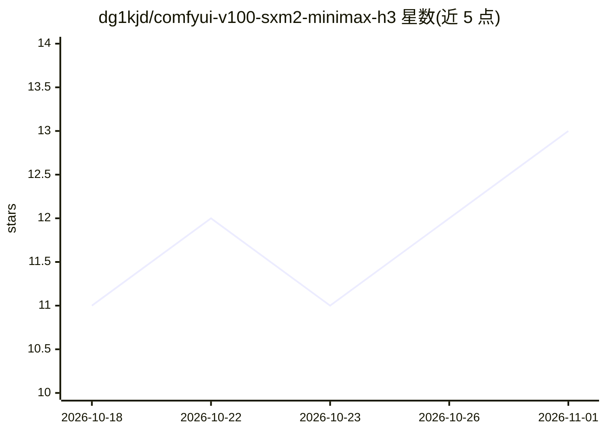

# dg1kjd/comfyui-v100-sxm2-minimax-h3

⭐ 13 · Python · GPL-3.0 · 推送 2026-08-14 · [GitHub](https://github.com/dg1kjd/comfyui-v100-sxm2-minimax-h3) · 个人维护

**ComfyUI 多 GPU 节点：让 MiniMax H3 视频生成在多卡 V100 上并行加速**

面向拥有两块及以上 NVIDIA V100（或其他老款多卡机器）的 ComfyUI 用户，提供 MiniMax H3 视频生成的 Ulysses 序列并行方案：在模型加载器与采样器之间插入节点，将生成与 VAE 解码拆分到多块 GPU，另附 RescaleCFG 与 CFG Interval 节点。作者实测 8×V100 上同片段从约 19 分钟降到约 7 分钟。需 ComfyUI 含 H3 支持（PR #15224），通信走 NVLink、单进程每 GPU 一线程，无需 NCCL/torchrun；序列切分可验证为精确一致，默认 fp16 优化则数值等价而非逐位一致。

## 筛选速览

| 维度 | 判定 | 备注 |
|---|---|---|
| AI 角色 | `ai-ecosystem` | LLM/agent 周边工具 |
| 许可风险 | `viral` | GPL-3.0 |
| 部署形态 | `None` |  |
| 模型依赖 | — | README 未给出锁定关系 |
| 硬件要求 | — | 无带数字的原话,不猜 |
| 安装摩擦 | `medium` | 含编译或系统依赖之一 |
| 成熟度 | — | 结构信号不足 |

## 能力要点

- Ulysses 序列并行节点，8×V100 实测约 19 分钟降至约 7 分钟
- 另含 Parallel VAE Decode、RescaleCFG、CFG Interval 三个节点
- 单进程、每 GPU 一线程，无需 NCCL 与 torchrun，通信走 NVLink
- 提供 COMFY_MINIMAX_SP_SELFTEST 自检与逐位复现开关（关闭 fp16 优化）

## 适用场景

- 在多卡 V100/DGX-1 机器上缩短 MiniMax H3 长视频渲染时间
- 大分辨率、长帧数的大批量渲染任务分摊到多块 GPU
- 在共享工作流中保留节点，单 GPU 用户设置 num_gpus=1 不受影响

## 场景标签

`视频生成` · 领域:内容生成

## 证据(README 行号)

> L3: **Makes MiniMax H3 video generation practical on multi-GPU NVIDIA V100 machines.**
> L99: Add **MiniMax H3 Sequence Parallel** to your H3 workflow, between the model loader
> L104: UNET Loader → (sigma shift, etc.) → MiniMax H3 Sequence Parallel → KSampler

## 星数曲线

2026-10-18 11 → 2026-11-01 13（+2）

---
*卡片 v1 · prompt 1.4 · 生成 2026-10-31 · 置信度 high · 依据 README sha `22ebfd246ded` · [字段定义](../../DATASET.md)*
