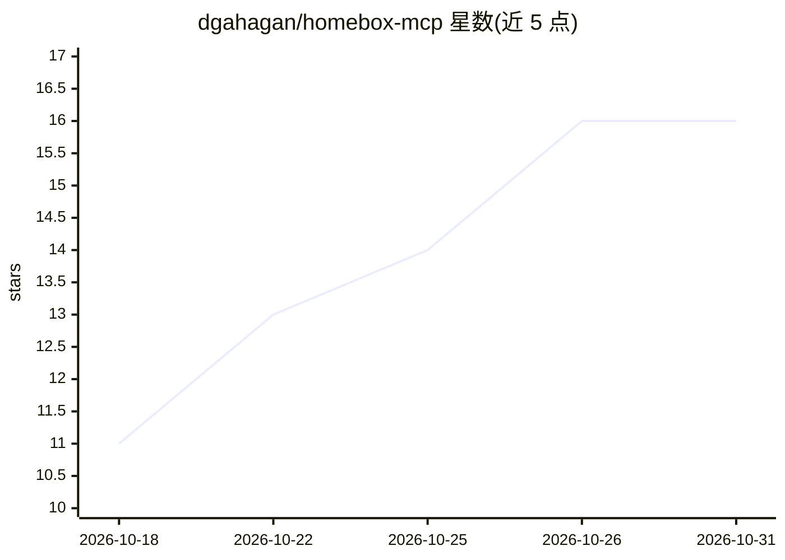

# dgahagan/homebox-mcp

⭐ 16 · Python · MIT · 推送 2026-10-29 · [GitHub](https://github.com/dgahagan/homebox-mcp) · [官网](https://pypi.org/project/homebox-mcp/) · 个人维护

**让 Claude 等 MCP 客户端用自然语言管理 Homebox 家庭库存的服务器**

封装 Homebox REST API 的 MCP server，供 Claude Code / Claude Desktop 等 MCP 客户端以自然语言操作家庭库存：问答检索、物品录入与编辑（create_item/set_item/move_item 等）、CSV 批量导入导出、附件管理（含 HEIC 自动转 JPEG）、维护日志、保修到期查询、库存统计，以及生成带 QR 的可打印标签。读操作支持模糊匹配，写操作要求精确标识符，删除均需 confirm 确认。要求 Homebox 0.26+（entities API）与 API key，通过 uvx 从 PyPI 运行或 git clone 后用 uv run 运行。

## 筛选速览

| 维度 | 判定 | 备注 |
|---|---|---|
| AI 角色 | `ai-ecosystem` | LLM/agent 周边工具 |
| 许可风险 | `permissive` | MIT |
| 部署形态 | `library` | 以包/库形式分发 |
| 模型依赖 | — | README 未给出锁定关系 |
| 硬件要求 | — | 无带数字的原话,不猜 |
| 安装摩擦 | `low` | 无编译、无系统依赖或容器化 |
| 成熟度 | — | 结构信号不足 |

## 能力要点

- 约 39 个工具覆盖检索、录入、编辑、维护日志、报表、附件与标签
- 写操作要求精确标识符，删除带 confirm 门槛与 destructiveHint 注解
- 支持 CSV 批量导入导出与库存价值统计
- 生成含 QR 码的可打印 PNG 标签

## 适用场景

- 问 AI '冲击起子在哪'、'Tote B-3 里有什么' 并直接得到答案
- 拍照录入新物品并附上说明书和收据
- 查询今年到期的保修、按位置或标签统计库存价值
- 批量导入 CSV 并打印位置标签贴在收纳箱上

## 场景标签

 · 领域:家庭库存管理/智能体工具

## 证据(README 行号)

> L7: An MCP server over the
> L8: Homebox REST API, so an MCP client like Claude can

## 星数曲线

2026-10-18 11 → 2026-10-31 16（+5）

---
*卡片 v1 · prompt 1.4 · 生成 2026-10-30 · 置信度 high · 依据 README sha `5f5b17d636b7` · [字段定义](../../DATASET.md)*
