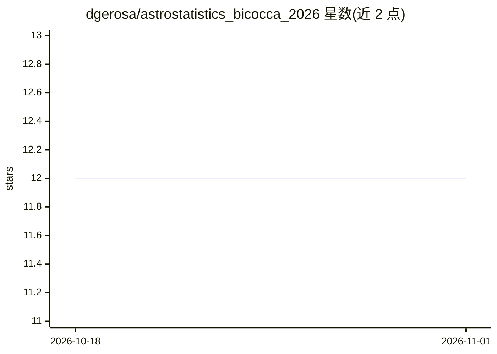

# dgerosa/astrostatistics_bicocca_2026

⭐ 12 · Jupyter Notebook · GPL-3.0 · 推送 2026-10-28 · [GitHub](https://github.com/dgerosa/astrostatistics_bicocca_2026) · 组织维护

**米兰比可卡大学天体物理硕士的天体统计与机器学习课程仓库**

面向 University of Milano-Bicocca 天体物理学硕士学生的课程仓库，由 Davide Gerosa 主讲（2026 年版，6 学分/21 讲）。内容以讲授大纲形式组织，覆盖概率统计、频率派与贝叶斯推断（MCMC、嵌套采样）、聚类、降维、回归、分类、深度学习（含 Transformers/LLM）与时间序列分析，几乎全部取自天文学案例，要求学生自带可编程设备做动手练习。README 还提供教科书与免费资源清单、课程日程与历届版本链接；仓库本身不含代码安装入口。

## 筛选速览

| 维度 | 判定 | 备注 |
|---|---|---|
| AI 角色 | `ai-knowledge` | 知识聚合/清单类 |
| 许可风险 | `viral` | GPL-3.0 |
| 部署形态 | `None` |  |
| 模型依赖 | — | README 未给出锁定关系 |
| 硬件要求 | — | 无带数字的原话,不猜 |
| 安装摩擦 | `low` | 无编译、无系统依赖或容器化 |
| 成熟度 | — | 结构信号不足 |

## 能力要点

- 25 讲大纲覆盖统计推断、机器学习与深度学习（至 Transformers/LLM）
- 以天文学数据为案例，理论推导配合动手编程练习
- 提供主教材（Ivezić 等 2012）及十余本免费参考资源清单
- 记录 2022-2026 历届课程版本与致谢来源课程

## 适用场景

- 按大纲系统学习天体统计与机器学习方法
- 查找天体统计领域的免费教材与讲义资源
- 参考其他高校同类课程的链接与结构

## 场景标签

`教程课程` · 领域:学习与行业

## 证据(README 行号)

> L8: The use of statistics is ubiquitous in astronomy and astrophysics. Modern advances are made possible by the applicat
> L4: University of Milano-Bicocca, 2026.

## 星数曲线

2026-10-18 12 → 2026-11-01 12（+0）

---
*卡片 v1 · prompt 1.4 · 生成 2026-11-01 · 置信度 high · 依据 README sha `f2c4335fad19` · [字段定义](../../DATASET.md)*
