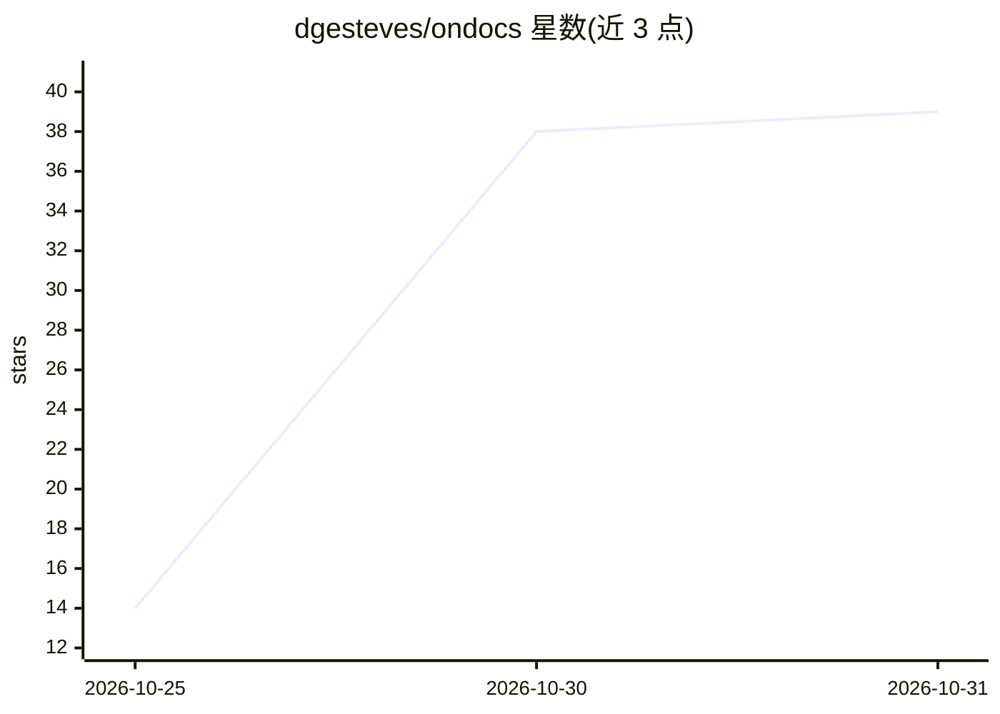

# dgesteves/ondocs

⭐ 39 · TypeScript · MIT · 推送 2026-10-30 · [GitHub](https://github.com/dgesteves/ondocs) · [官网](https://ondocs.vercel.app) · 个人维护

**给自有文档站加带引用的 Ask AI 与 MCP 服务，自托管**

面向自建开发者文档（Starlight/Docusaurus/VitePress/Next.js 等）的开源方案：站点构建时生成单一静态索引 ask-index.json，驱动面向读者的 ⌘I 问答框（流式回答、编号引用定位到章节）、面向编码代理的 MCP 服务（search/fetch/list_pages），并输出 llms.txt 与 .md 页面副本。模型密钥归用户，通过 AI SDK 支持 OpenAI/Anthropic/Gemini/xAI/Workers AI 等；检索为内存中 BM25+向量、倒数排序融合，默认关键词检索不调模型。提供 npm 包、插件、脚本标签与 CLI（npx ondocs init/index/dev），可部署到 Vercel/Netlify/Cloudflare/GitHub Pages。需 Node.js 22.12+ 与 AI SDK 7。

## 筛选速览

| 维度 | 判定 | 备注 |
|---|---|---|
| AI 角色 | `ai-native` | 本体是模型或模型工具 |
| 许可风险 | `permissive` | MIT |
| 部署形态 | `library` | 以包/库形式分发 |
| 模型依赖 | locked-api |  |
| 硬件要求 | — | 无带数字的原话,不猜 |
| 安装摩擦 | `low` | 无编译、无系统依赖或容器化 |
| 成熟度 | — | 结构信号不足 |

## 能力要点

- 一个静态索引同时驱动读者问答框、agent MCP 服务与 llms.txt 输出
- 自托管、自备模型密钥，无厂商账户、无向量数据库
- BM25 与向量检索经倒数排序融合，默认关键词检索不调用模型
- 默认开启限流、预算上限、回答缓存与 Turnstile 人机校验

## 适用场景

- 给自己的 Starlight/Docusaurus/VitePress 文档站添加带引用的 Ask AI
- 为 Cursor/VS Code/Claude Code 等编码代理提供本站文档 MCP 服务
- 随构建自动生成 llms.txt 和 Markdown 版页面

## 场景标签

`RAG` `语义搜索` `文档问答` · 领域:知识与检索

## 证据(README 行号)

> L3: **Open-source Ask AI for your docs.** Cited answers on your own model key, and an MCP server for coding agents, from
> L43: - **An Ask box for people.** A ⌘I dialog that streams a short answer from your model, with numbered citations to th

## 星数曲线

2026-10-25 14 → 2026-10-31 39（+25）

---
*卡片 v1 · prompt 1.4 · 生成 2026-10-30 · 置信度 high · 依据 README sha `6f9be15fb5f5` · [字段定义](../../DATASET.md)*
