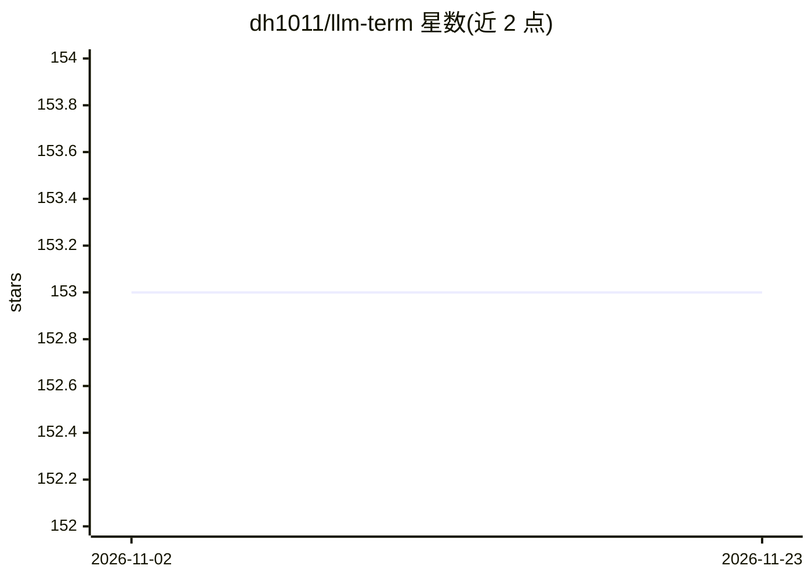

# dh1011/llm-term

⭐ 153 · C · MIT · 推送 2026-07-05 · [GitHub](https://github.com/dh1011/llm-term) · 个人维护

**把自然语言转为 shell 命令并确认后执行的 CLI 工具**

Rust 编写的命令行工具：读取用户的英文描述，调用 OpenAI 语言模型生成对应 shell 命令，展示生成结果并在用户按 y 确认后才执行；另有 C/Cosmopolitan 可移植单文件二进制移植版（可产出 Windows 可启动的 llm-term.exe，Unix 下改名亦可运行）。两种实现均以可执行文件旁的 config.json/cache.json 保存配置与缓存，提供 --config 初始化设置。需从源码用 cargo build 或 make 构建。

## 筛选速览

| 维度 | 判定 | 备注 |
|---|---|---|
| AI 角色 | `ai-native` | 本体是模型或模型工具 |
| 许可风险 | `permissive` | MIT |
| 部署形态 | `desktop` | 安装包/桌面程序 |
| 模型依赖 | — | README 未给出锁定关系 |
| 硬件要求 | — | 无带数字的原话,不猜 |
| 安装摩擦 | `medium` | 含编译或系统依赖之一 |
| 成熟度 | — | 结构信号不足 |

## 能力要点

- 自然语言生成 shell 命令，执行前展示并要求显式 y 确认
- Rust 主实现 + Cosmopolitan 可移植 C 移植版双实现
- 配置与缓存以用户可见的 config.json/cache.json 形式保存
- 提供 --config 设置命令与独立文档（config/cache/providers/portable-build）

## 适用场景

- 不熟悉命令行语法时用自然语言生成命令
- 减少记忆 shell 参数，快速得到可执行的命令
- 在 Windows/Unix 上使用同一可移植二进制

## 场景标签

`代码生成` · 领域:编码与开发

## 证据(README 行号)

> L3: LLM-Term is a CLI that turns plain English prompts into shell commands, shows the generated command, and asks before
> L75: Generated commands are displayed before execution. A command only runs after explicit `y` confirmation.

## 星数曲线

2026-11-02 153 → 2026-11-23 153（+0）

---
*卡片 v1 · prompt 1.4 · 生成 2026-11-17 · 置信度 high · 依据 README sha `ee821bb89a77` · [字段定义](../../DATASET.md)*
