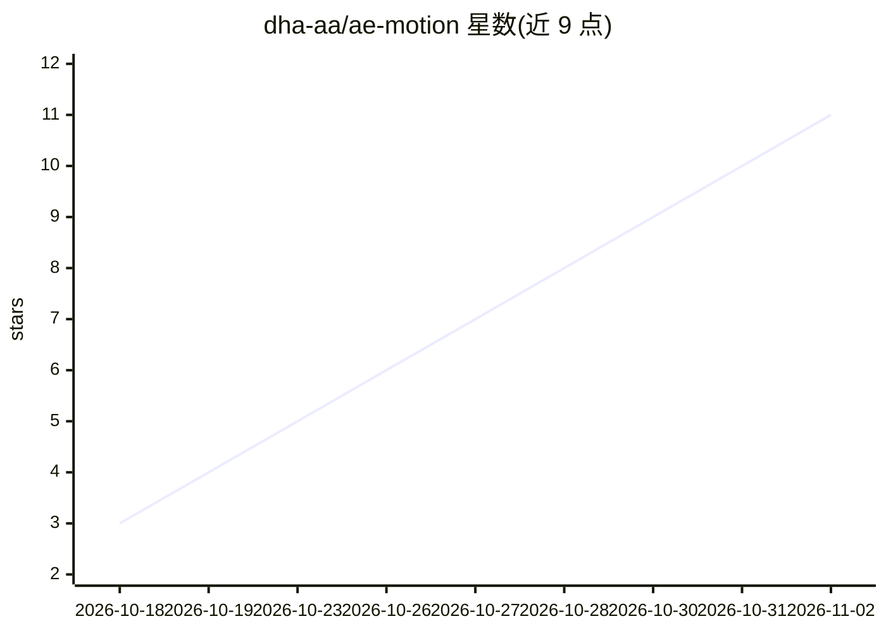

# dha-aa/ae-motion

⭐ 11 · TypeScript · MIT · 推送 2026-10-23 · [GitHub](https://github.com/dha-aa/ae-motion) · [官网](https://dha-aa.vercel.app/blog/building-ae-motion.html) · 个人维护

**让 Claude 在 After Effects 中制作动效的 MCP 服务器（78 个工具）**

MCP 服务器，分两部分：本机小程序负责与 Claude 通信，After Effects 内的扩展面板执行指令，在用户打开的工程中创建合成、图层、关键帧、弹簧动画、文字揭示、转场、遮罩、特效、3D 摄像机、节拍同步音频，并通过 aerender 执行渲染检查。生成的是普通 AE 图层，可编辑可撤销。要求 After Effects 2022+（Mac/Windows）、Claude Code 或 Claude Desktop，支持让 Claude 代为安装或手动 git clone 安装，需在 AE 中开启脚本权限并打开面板。

## 筛选速览

| 维度 | 判定 | 备注 |
|---|---|---|
| AI 角色 | `ai-ecosystem` | LLM/agent 周边工具 |
| 许可风险 | `permissive` | MIT |
| 部署形态 | `None` |  |
| 模型依赖 | locked-api |  |
| 硬件要求 | — | 无带数字的原话,不猜 |
| 安装摩擦 | `low` | 无编译、无系统依赖或容器化 |
| 成熟度 | — | 结构信号不足 |

## 能力要点

- 78 个工具覆盖合成、图层、关键帧、特效、3D 摄像机、音频与渲染
- 通过 CEP 面板在打开的 AE 工程中直接生成可编辑的普通图层
- 支持节拍标记、音频联动与 aerender 渲染
- 可用自然语言让 Claude 代为完成安装流程

## 适用场景

- 用对话让 Claude 在我的 AE 工程里搭动画和转场
- 让 AI 生成标题动效、弹簧动画并预览帧
- 通过 AI 批量操作图层、遮罩与时间线剪辑

## 场景标签

`GUI 自动化` `视频生成` · 领域:效率与自动化

## 证据(README 行号)

> L13: Claude can't use After Effects by itself. This project gives it a way in, with two parts:
> L70: 78 tools, grouped by what they're for. You never call them yourself: ask in plain words, and Claude picks the right

## 星数曲线

2026-10-18 3 → 2026-11-02 11（+8）

---
*卡片 v1 · prompt 1.4 · 生成 2026-11-02 · 置信度 high · 依据 README sha `e853eeb84bbd` · [字段定义](../../DATASET.md)*
