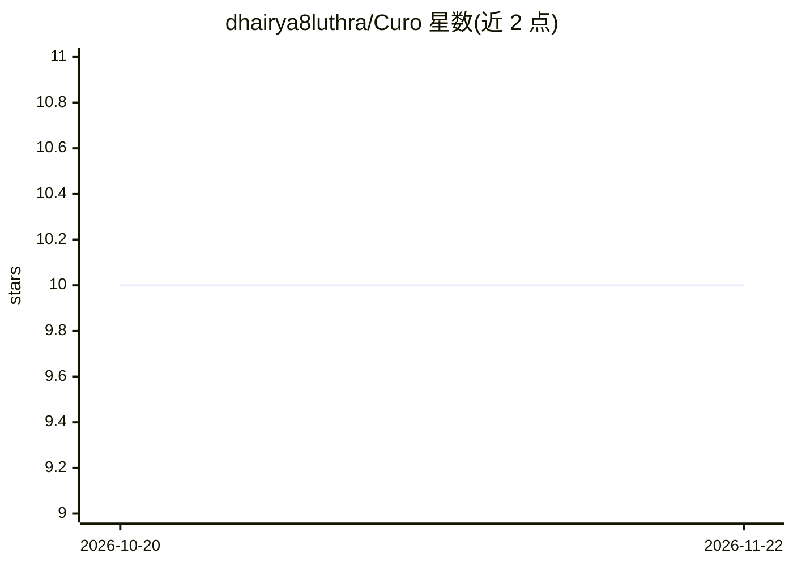

# dhairya8luthra/Curo

⭐ 10 · Jupyter Notebook · 推送 2025-12-24 · [GitHub](https://github.com/dhairya8luthra/Curo) · [官网](https://curo-flame.vercel.app) · 组织维护

**AI 驱动的医疗管理平台：问诊、提醒、预约一体化**

Postman x BITS Pilani 黑客松期间开发的 Web 端医疗管理平台，前后端由 React 与 Express/Node.js 构成，部署于 Vercel。功能包括药物提醒（Firebase 推送加 cron 调度）、AI 问诊聊天（Corrective RAG 结合 Pinecone 向量检索与健康记录）、药价对比（实时抓取 PharmEasy/1mg/Apollo）、保险费用预测（LightGBM/随机森林转 ONNX 推理）、附近医疗机构查找、多因子登录、健康记录管理与 NexHealth 预约集成。后端依赖 Firebase、Supabase 等云端服务的凭据配置。

## 筛选速览

| 维度 | 判定 | 备注 |
|---|---|---|
| AI 角色 | `ai-native` | 本体是模型或模型工具 |
| 许可风险 | `none` | — |
| 部署形态 | `None` |  |
| 模型依赖 | — | README 未给出锁定关系 |
| 硬件要求 | — | 无带数字的原话,不猜 |
| 安装摩擦 | `low` | 无编译、无系统依赖或容器化 |
| 成熟度 | — | 结构信号不足 |

## 能力要点

- Corrective RAG 问诊聊天：Pinecone 向量检索结合用户健康记录，并带反馈修正回路
- LightGBM/随机森林模型转 ONNX 部署，实时预测保险费用
- cron 任务加 Firebase Cloud Messaging 实现跨时区药物提醒
- 实时抓取多家在线药房价格并做 JSON 聚合对比

## 适用场景

- 通过对话向 AI 医生咨询健康问题并联动个人健康记录
- 设置药物提醒避免漏服
- 在线比价购买药品
- 查找附近的医院、诊所与实验室并预约

## 场景标签

`RAG` `聊天机器人` `网页抓取` · 领域:效率与自动化

## 证据(README 行号)

> L9: Welcome to **Curo!** Our mission is to make healthcare management seamless, efficient, and more accessible. By integ
> L66: ### 2. MediChat AI Doctor 🤖
> L68: - **Technology:** Leveraging **Corrective Retrieval-Augmented Generation (RAG)** integrated with Pinecone for simil

## 星数曲线

2026-10-20 10 → 2026-11-22 10（+0）

---
*卡片 v1 · prompt 1.4 · 生成 2026-11-19 · 置信度 high · 依据 README sha `49517e8d3aa7` · [字段定义](../../DATASET.md)*
