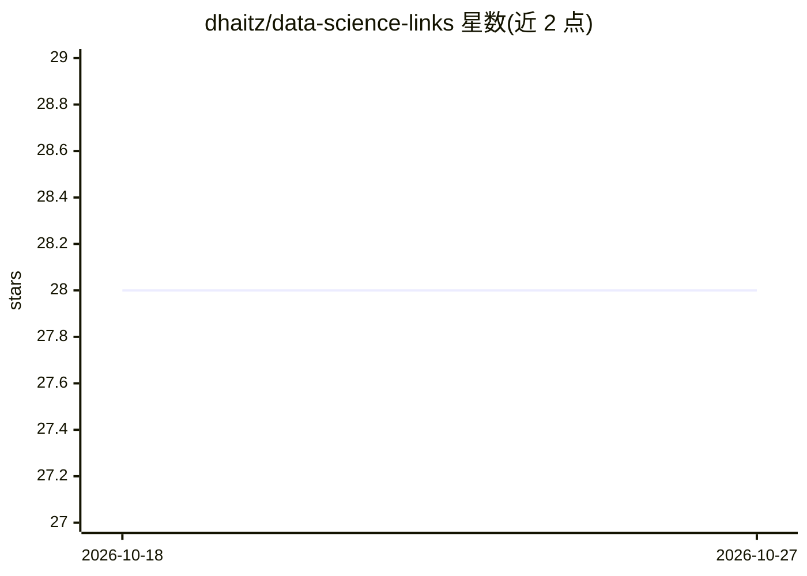

# dhaitz/data-science-links

⭐ 28 · 推送 2026-01-27 · [GitHub](https://github.com/dhaitz/data-science-links) · [官网](https://data-science-links.netlify.app) · 个人维护

**数据科学职业与技术文章的策展链接清单**

由个人维护的策展清单仓库，收录数据科学与软件工程相关的文章、演讲与博客链接，按通用建议、职业建议、敏捷实践、经验教训、企业政治、软技能、演示技能、机器学习技术建议、Git、代码评审、GenAI 与 LLM 等章节组织。内容面向数据科学从业者的职业成长与工程实践，读者可通过 pull request 补充条目。仓库本身不提供代码或安装运行方式。

## 筛选速览

| 维度 | 判定 | 备注 |
|---|---|---|
| AI 角色 | `ai-knowledge` | 知识聚合/清单类 |
| 许可风险 | `none` | — |
| 部署形态 | `None` |  |
| 模型依赖 | — | README 未给出锁定关系 |
| 硬件要求 | — | 无带数字的原话,不猜 |
| 安装摩擦 | `low` | 无编译、无系统依赖或容器化 |
| 成熟度 | — | 结构信号不足 |

## 能力要点

- 按 10+ 主题章节组织的数据科学与软技能文章链接
- 涵盖敏捷实践、企业政治、演示技能、代码评审等职业主题
- 含 GenAI 与 LLM 相关文章条目，通过 pull request 社区维护

## 适用场景

- 寻找数据科学职业发展与软技能方面的阅读材料
- 查阅机器学习工程与软件工程实践经验文章
- 了解数据科学团队协作与敏捷实践的参考资料

## 场景标签

`精选清单` · 领域:学习与行业

## 证据(README 行号)

> L1: # Data Science Links
> L3: Links to great data science articles or videos. Feel free to add stuff via pull request here.

## 星数曲线

2026-10-18 28 → 2026-10-27 28（+0）

---
*卡片 v1 · prompt 1.4 · 生成 2026-10-26 · 置信度 high · 依据 README sha `55fd704d7160` · [字段定义](../../DATASET.md)*
