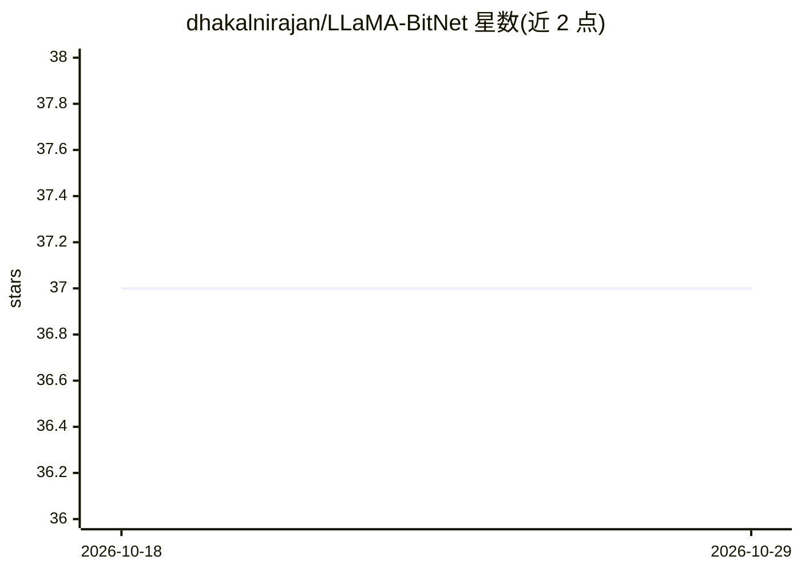

# dhakalnirajan/LLaMA-BitNet

⭐ 37 · Python · MIT · 推送 2026-03-21 · [GitHub](https://github.com/dhakalnirajan/LLaMA-BitNet) · [官网](https://arxiv.org/pdf/2402.17764) · 个人维护

**基于 LLaMA 2 架构的 BitNet 1.58-bit 模型训练代码库**

提供在 LLaMA 2 架构上训练 BitNet 模型的代码：将 decoder 层中的 nn.Linear 替换为 BitLinear（内含无参数 RMSNorm 与 absmean 量化到 {-1,0,+1}，训练用直通估计器 STE），embedding 与 lm_head 保持全精度，RoPE/SwiGLU 等不变。默认在 OpenWebText2 的 15% 子集（上下文长度 256）上训练约 7800 万参数模型，支持自定义数据集重分词。通过 python train.py 训练、inference.py 运行推理；运行未修改代码需先在 Meta 官网申请 LLaMA 权重访问权限。

## 筛选速览

| 维度 | 判定 | 备注 |
|---|---|---|
| AI 角色 | `ai-native` | 本体是模型或模型工具 |
| 许可风险 | `permissive` | MIT |
| 部署形态 | `library` | 以包/库形式分发 |
| 模型依赖 | — | README 未给出锁定关系 |
| 硬件要求 | — | 无带数字的原话,不猜 |
| 安装摩擦 | `low` | 无编译、无系统依赖或容器化 |
| 成熟度 | — | 结构信号不足 |

## 能力要点

- convert_to_bitnet() 按论文将 nn.Linear 替换为 BitLinear 并移除层内 Layernorm
- BitLinear 前向：无参数 RMSNorm + int8 absmax 激活量化 + 三值权重量化（STE）
- 默认使用 OpenWebText2 15% 子集训练，支持手动分词替换数据集
- 训练提供 steps/batch-size/lr 等参数与可选 W&B 日志，每 1000 步保存 checkpoint

## 适用场景

- 复现 1.58-bit LLM 论文思路，训练自己的 BitNet 小模型
- 学习 BitLinear 量化与 STE 训练机制的实现
- 在自定义数据集上训练并推理 BitNet 变体模型

## 场景标签

`模型训练` `模型量化` · 领域:训练与推理

## 证据(README 行号)

> L3:  Welcome to the LLaMA-BitNet repository. Our repository is your gateway to training your very own BitNet model, as h
> L56: 1. **Replace** every `nn.Linear` inside `self_attn` and `mlp` with `BitLinear`.
> L75: python train.py

## 星数曲线

2026-10-18 37 → 2026-10-29 37（+0）

---
*卡片 v1 · prompt 1.4 · 生成 2026-10-25 · 置信度 high · 依据 README sha `d58b1ead17ae` · [字段定义](../../DATASET.md)*
