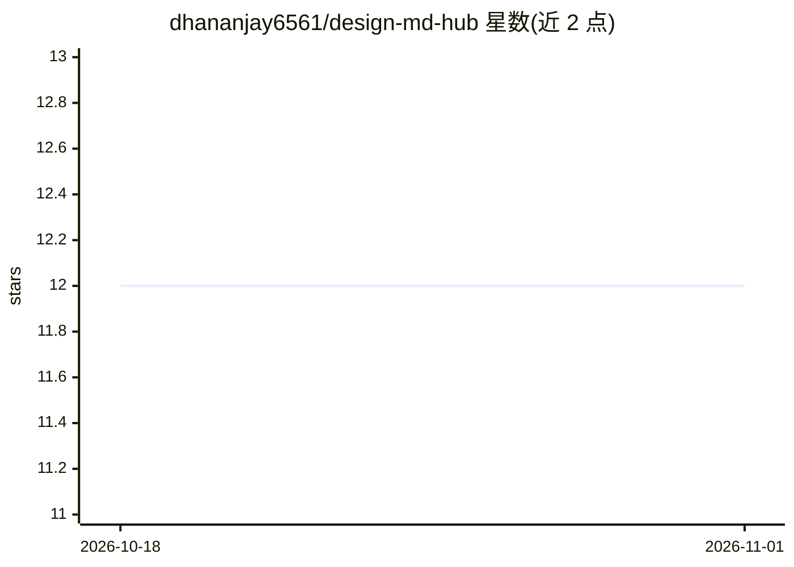

# dhananjay6561/design-md-hub

⭐ 12 · HTML · MIT · 推送 2026-08-04 · [GitHub](https://github.com/dhananjay6561/design-md-hub) · [官网](https://dhananjay6561.github.io/design-md-hub/index.html) · 个人维护

**120 个品牌设计系统的纯文本 DESIGN.md 规格合集，供 AI 编程代理读取**

收录 120 个品牌的设计规格文件，每个品牌对应一份 DESIGN.md（色彩 token、字体、组件模式、间距、布局原则与使用禁忌）和一个可直接浏览器打开的 preview.html。规格从品牌线上生产站点逆向提取，无法确认的值不收录而非猜测。使用方式为将文件复制到项目根目录，指示 AI 编程代理按其生成匹配品牌风格的界面。文件声明为非官方参考资料，商标归各品牌所有。

## 筛选速览

| 维度 | 判定 | 备注 |
|---|---|---|
| AI 角色 | `ai-knowledge` | 知识聚合/清单类 |
| 许可风险 | `permissive` | MIT |
| 部署形态 | `None` |  |
| 模型依赖 | — | README 未给出锁定关系 |
| 硬件要求 | — | 无带数字的原话,不猜 |
| 安装摩擦 | `low` | 无编译、无系统依赖或容器化 |
| 成熟度 | — | 结构信号不足 |

## 能力要点

- 120 个品牌各含 DESIGN.md 与自包含 preview.html
- token 从品牌线上生产站点提取，未确认的值不猜测
- 使用方式为复制文件入项目并指示编程代理遵循
- MIT 许可，无付费墙、无注册、无 API key

## 适用场景

- 让 AI 编程代理按某品牌视觉风格生成 UI
- 原型设计时参考真实品牌的配色与字体规范
- 为自己的项目挑选并套用某个品牌的设计语言

## 场景标签

`提示工程` `精选清单` · 领域:Agent 开发

## 证据(README 行号)

> L5: 120 brands, each reverse engineered from its live production site: the real colors, fonts, components and guardrails
> L22: AI coding agents read this file to generate UI that matches the real thing.

## 星数曲线

2026-10-18 12 → 2026-11-01 12（+0）

---
*卡片 v1 · prompt 1.4 · 生成 2026-11-01 · 置信度 high · 依据 README sha `6cff4d06b0b2` · [字段定义](../../DATASET.md)*
