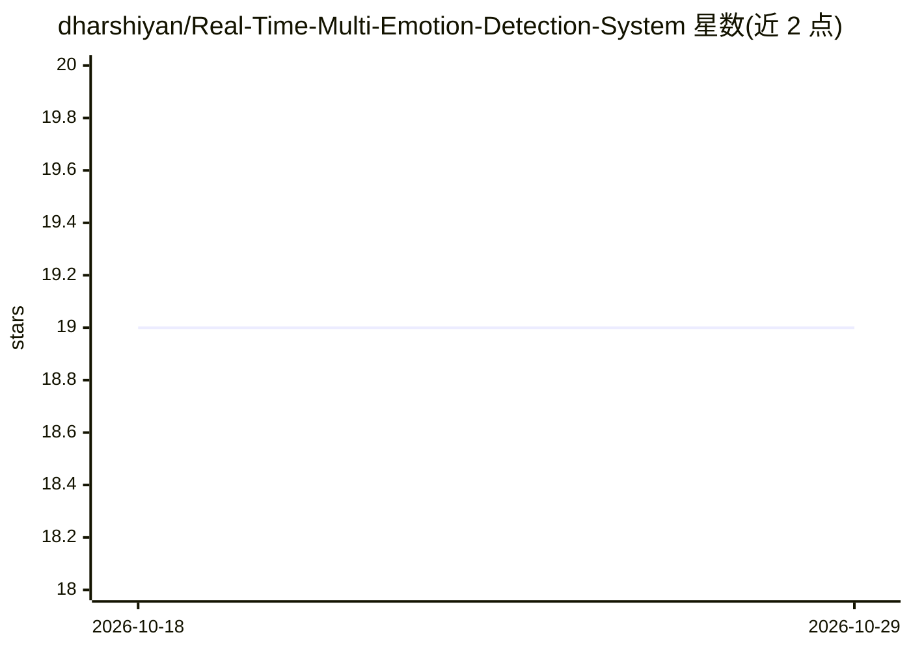

# dharshiyan/Real-Time-Multi-Emotion-Detection-System

⭐ 19 · Python · MIT · 推送 2026-07-28 · [GitHub](https://github.com/dharshiyan/Real-Time-Multi-Emotion-Detection-System) · 个人维护

**实时摄像头人脸表情/情绪识别系统（CNN，7 类情绪）**

基于 TensorFlow 与 OpenCV 的实时面部情绪识别系统：从摄像头视频流中用 OpenCV DNN 检测人脸，再用在 FER2013 数据集上训练的 CNN 将表情分类为 7 类情绪（Angry/Disgust/Fear/Happy/Sad/Surprise/Neutral），附带 FPS 计数、情绪平滑、模型检查点保存与数据增强。提供训练脚本与实时检测脚本，通过 git clone 源码并 pip 安装依赖运行；验证准确率约 60%–75%，实时 15–30 FPS。

## 筛选速览

| 维度 | 判定 | 备注 |
|---|---|---|
| AI 角色 | `ai-native` | 本体是模型或模型工具 |
| 许可风险 | `permissive` | MIT |
| 部署形态 | `library` | 以包/库形式分发 |
| 模型依赖 | — | README 未给出锁定关系 |
| 硬件要求 | — | 无带数字的原话,不猜 |
| 安装摩擦 | `low` | 无编译、无系统依赖或容器化 |
| 成熟度 | — | 结构信号不足 |

## 能力要点

- OpenCV DNN 人脸检测 + TensorFlow CNN 情绪分类的实时流水线
- 7 类情绪分类，含预测平滑与 FPS 监控
- 提供训练与实时推理脚本，支持数据增强与检查点保存

## 适用场景

- 通过摄像头实时识别面部表情情绪
- 学习 CNN 与实时计算机视觉的实现流程
- 作为行为分析或情绪感知应用的原型基础

## 场景标签

`人脸识别` · 领域:感知与多模态

## 证据(README 行号)

> L5: An AI-powered real-time facial emotion recognition system developed using TensorFlow, OpenCV, and Deep Learning. The
> L7: The project uses a Convolutional Neural Network (CNN) trained on the FER2013 dataset for emotion classification and 

## 星数曲线

2026-10-18 19 → 2026-10-29 19（+0）

---
*卡片 v1 · prompt 1.4 · 生成 2026-10-29 · 置信度 mid · 依据 README sha `980f61693dda` · [字段定义](../../DATASET.md)*
