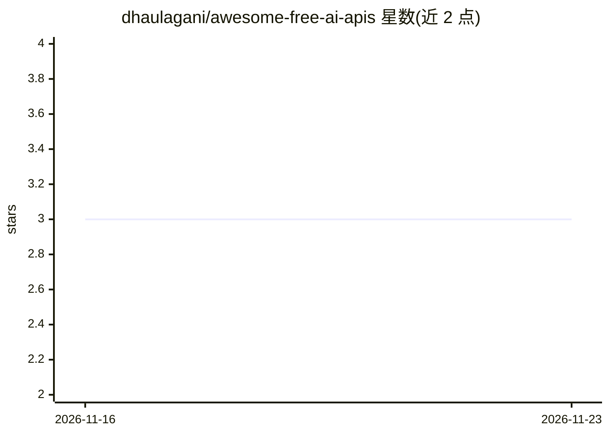

# dhaulagani/awesome-free-ai-apis

⭐ 3 · 推送 2026-11-22 · [GitHub](https://github.com/dhaulagani/awesome-free-ai-apis) · 个人维护

**为开发者提供的每日核验免费 AI 推理 API 目录**

一个由自动化守护进程每日核验的免费 AI API 目录清单：按类别组织 30+ 家提供免费额度的推理端点，包括 LPU/专用推理、无服务器免费层、聚合网关、零密钥公共端点、嵌入检索、语音与图像生成。每 24 小时由后台验证引擎对各提供方文档与面板端点发送延迟探测，免费层被弃用或配额收紧时标记更新，延迟基准经 GitHub Actions 自动提交。附带付费赞助位机制与 PR 提交通道。

## 筛选速览

| 维度 | 判定 | 备注 |
|---|---|---|
| AI 角色 | `ai-knowledge` | 知识聚合/清单类 |
| 许可风险 | `none` | — |
| 部署形态 | `None` |  |
| 模型依赖 | — | README 未给出锁定关系 |
| 硬件要求 | — | 无带数字的原话,不猜 |
| 安装摩擦 | `low` | 无编译、无系统依赖或容器化 |
| 成熟度 | — | 结构信号不足 |

## 能力要点

- 每日自动健康检查与延迟探测，结果经 GitHub Actions 提交
- 按推理、聚合网关、嵌入、语音、图像等类别组织目录
- 收录零密钥公共端点（无需注册的免费 API）
- 免费层变动自动标记并更新

## 适用场景

- 为零成本原型项目寻找可用的免费 LLM 推理 API
- 对比各家免费额度与 RPM 配后再申请 API key
- 定期核查所依赖免费层是否仍在线可用

## 场景标签

`精选清单` · 领域:学习与行业

## 证据(README 行号)

> L3: > **A curated, live-monitored directory of high-generosity free tier AI inference APIs, reasoning models (DeepSeek R
> L18: This repository runs an **autonomous verification engine** that actively tests each provider daily, confirming that
> L85: This repository is maintained automatically by a background verification daemon:

## 星数曲线

2026-11-16 3 → 2026-11-23 3（+0）

---
*卡片 v1 · prompt 1.4 · 生成 2026-11-22 · 置信度 high · 依据 README sha `1420546779f6` · [字段定义](../../DATASET.md)*
