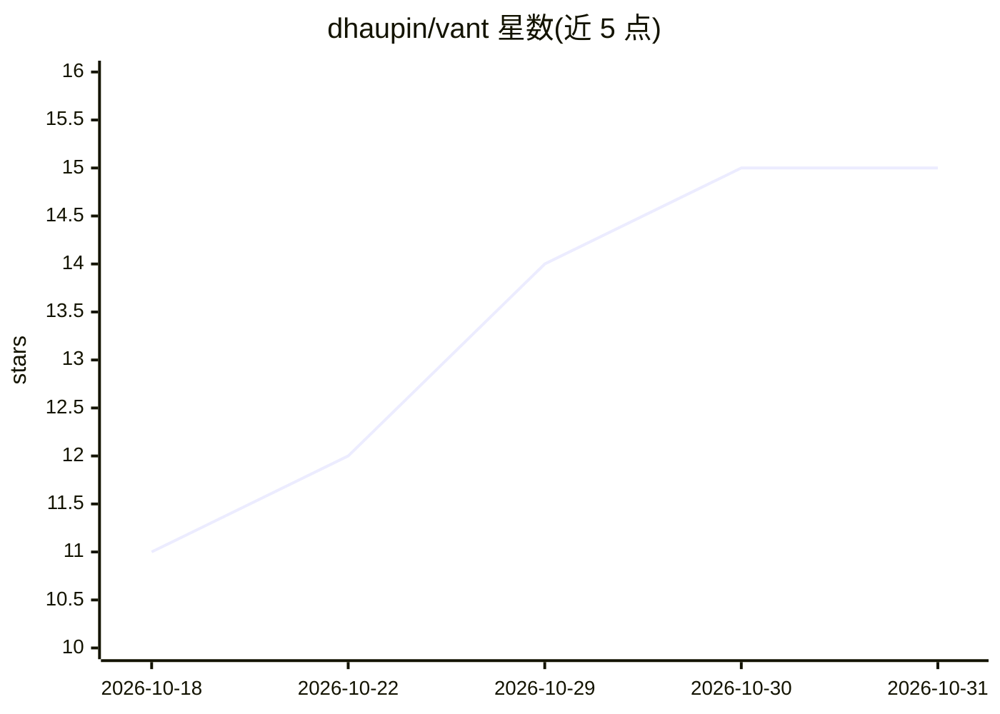

# dhaupin/vant

⭐ 15 · JavaScript · MIT · 推送 2026-10-30 · [GitHub](https://github.com/dhaupin/vant) · [官网](https://vant.creadev.org) · 个人维护

**面向长期运行 agent 的记忆优先操作系统与运行时**

Vant 是一个用 Node.js 编写的 agent OS：将 agent 的身份、目标、经验与错误以纯 markdown 文件存放在用户自己的 git 仓库中，唤醒时读取、休眠时写回，git 历史即记忆谱系。围绕大脑提供键值记忆库（TTL、沙箱门控）、语义检索（可插拔嵌入提供方）、多脑/多 agent 分支工作流、世代继承、MCP/REST/Web 接口、写前日志崩溃安全、加密脑备份（嵌入图像）、Webhook 中继与 React 仪表盘。通过 git clone 安装，明确声明不在 npm 上。当前版本 v0.8.6。

## 筛选速览

| 维度 | 判定 | 备注 |
|---|---|---|
| AI 角色 | `ai-ecosystem` | LLM/agent 周边工具 |
| 许可风险 | `permissive` | MIT |
| 部署形态 | `None` |  |
| 模型依赖 | — | README 未给出锁定关系 |
| 硬件要求 | — | 无带数字的原话,不猜 |
| 安装摩擦 | `low` | 无编译、无系统依赖或容器化 |
| 成熟度 | — | 结构信号不足 |

## 能力要点

- markdown 大脑文件存于用户仓库，git 历史构成记忆谱系，可用 cat 直接读取
- MCP 服务器（127.0.0.1:3457）自动将模块暴露为工具，任意 MCP 客户端可接入
- 键值记忆库（TTL/沙箱门控）、语义检索与 rerank、git 背书的引用回执
- 写前日志+原子写保证崩溃不产生撕裂记忆；Horcrux 将整个加密脑嵌入图像可随处恢复

## 适用场景

- 让跨会话的长期自主 agent 保留身份、目标与经验记忆
- 多 agent 团队按分支协作并受配额与治理约束
- 通过 MCP 通道为任意栈上的 agent 提供记忆与工具接口
- 在不同机器间经 GitHub API 同步与中继脑状态

## 场景标签

`Agent 框架` `多智能体` `Agent 记忆` · 领域:Agent 开发

## 证据(README 行号)

> L11: Vant is the memory-first agent OS. The soul is a brain: memory files the agent reads when it wakes and writes when 
> L13: Think of it as: **your soul that reincarnates with full memories.** In practice: on wake, the agent loads identity,
> L69: |**MCP Server**|Auto-wired JSON-RPC tools for any MCP client (optional)|

## 星数曲线

2026-10-18 11 → 2026-10-31 15（+4）

---
*卡片 v1 · prompt 1.4 · 生成 2026-10-31 · 置信度 high · 依据 README sha `4f46cbc3975b` · [字段定义](../../DATASET.md)*
