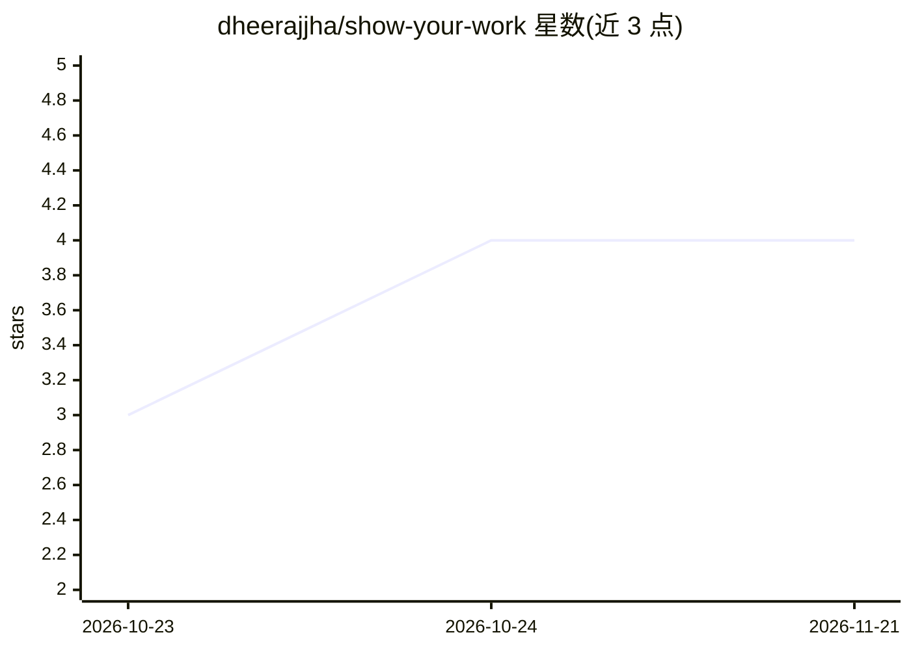

# dheerajjha/show-your-work

⭐ 4 · JavaScript · MIT · 推送 2026-10-23 · [GitHub](https://github.com/dheerajjha/show-your-work) · [官网](https://github.com/dheerajjha/show-your-work) · 个人维护 · 中文 README

**核验编码 agent 最终声明是否与实际运行一致的插件**

show-your-work 要求编码 agent 在最终消息中为每条声明附上实际执行的命令与输出。在 Claude Code 中以 Stop hook 读取会话日志，当最终消息包含会话日志无法支撑的声明时拦截一次并告知缺失内容；另以 SKILL.md 规则形式供 Codex、Cursor、Copilot CLI 等 agent 使用。自动检查目前仅在 Claude Code 运行，其他 agent 仅获得规则文本；声明识别仅支持英文；MIT 许可，无外部依赖，纯 Node.js 实现。

## 筛选速览

| 维度 | 判定 | 备注 |
|---|---|---|
| AI 角色 | `ai-ecosystem` | LLM/agent 周边工具 |
| 许可风险 | `permissive` | MIT |
| 部署形态 | `library` | 以包/库形式分发 |
| 模型依赖 | locked-api |  |
| 硬件要求 | — | 无带数字的原话,不猜 |
| 安装摩擦 | `low` | 无编译、无系统依赖或容器化 |
| 成熟度 | — | 结构信号不足 |

## 能力要点

- Stop hook 将最终消息声明与会话日志中的实际命令输出比对
- 支持 audit 命令扫描本机 ~/.claude/projects 过去 30 天的历史会话
- SessionStart hook 注入规则，无需手动调用
- 通过环境变量提供 warn/off 模式与上下文开关

## 适用场景

- 验证 agent 汇报的测试结果确实来自完整测试套件
- 审计历史编码会话中有多少最终声明缺乏运行支撑
- 为 Codex/Cursor/Copilot 等 agent 引入结果核验规则

## 场景标签

`编码 Agent` · 领域:编码与开发

## 证据(README 行号)

> L35: show-your-work makes the agent show the command and the output behind every

## 星数曲线

2026-10-23 3 → 2026-11-21 4（+1）

---
*卡片 v1 · prompt 1.4 · 生成 2026-11-21 · 置信度 high · 依据 README sha `c95d3cb6ee63` · [字段定义](../../DATASET.md)*
