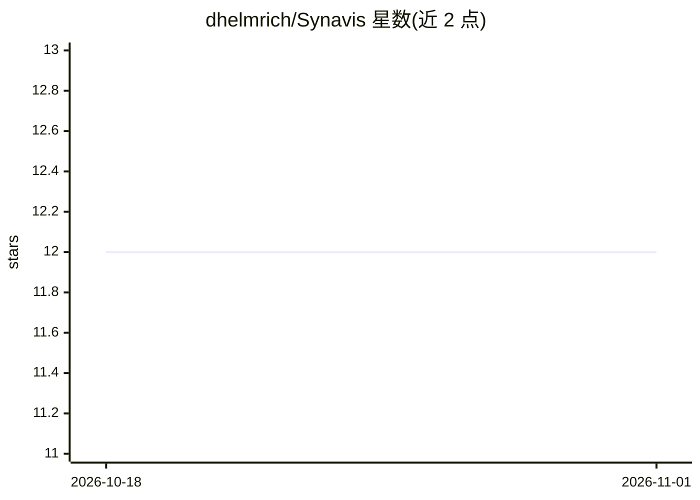

# dhelmrich/Synavis

⭐ 12 · C++ · MIT · 推送 2026-09-06 · [GitHub](https://github.com/dhelmrich/Synavis) · [官网](https://doi.org/10.1093/insilicoplants/diad022) · 个人维护

**连接模拟与 ML 工具到 Unreal Engine 的 C++ WebRTC 桥接器**

基于 Unreal Engine PixelStreaming（4.27 引入）的 C++ 桥接项目，用于将仿真程序与深度学习框架耦合到 Unreal Engine，实现远程可视化与场景交互。提供 DataConnector/MediaReceiver、经端口中继的桥接网络连接（面向 HPC 系统）、信令服务器以及 Python 封装 PySynavis。README 声明正在向动态工作流迁移，解码功能仍在开发中，并附合成数据生成相关论文。项目为作者论文的组成部分，获德国政府 InHPC-DE 项目资助。

## 筛选速览

| 维度 | 判定 | 备注 |
|---|---|---|
| AI 角色 | `ai-ecosystem` | LLM/agent 周边工具 |
| 许可风险 | `permissive` | MIT |
| 部署形态 | `None` |  |
| 模型依赖 | — | README 未给出锁定关系 |
| 硬件要求 | — | 无带数字的原话,不猜 |
| 安装摩擦 | `low` | 无编译、无系统依赖或容器化 |
| 成熟度 | `idea` | |

## 能力要点

- DataConnector/MediaReceiver 连接 DL 框架与仿真到 UE 并交互场景
- 端口中继式桥接网络，面向 HPC 系统
- 提供 Python 封装 PySynavis
- 应用于功能-结构植物模型合成数据生成流水线

## 适用场景

- 在 HPC 系统上做 Unreal Engine 远程可视化
- 将模拟与深度学习工具接入 UE 场景生成合成数据集
- 通过 TURN 式桥接网络连接前端瘦设备

## 场景标签

 · 领域:HPC 可视化/合成数据

## 证据(README 行号)

> L9: Synavis enables the coupling of simulation and ML tools to the Unreal Engine by leveraging PixelStreaming as data so
> L21: - DataConnector and MediaReceiver: Connect DL Frameworks and Simulations to UE and interact with the scene

## 星数曲线

2026-10-18 12 → 2026-11-01 12（+0）

---
*卡片 v1 · prompt 1.4 · 生成 2026-11-01 · 置信度 high · 依据 README sha `43d0044efc65` · [字段定义](../../DATASET.md)*
