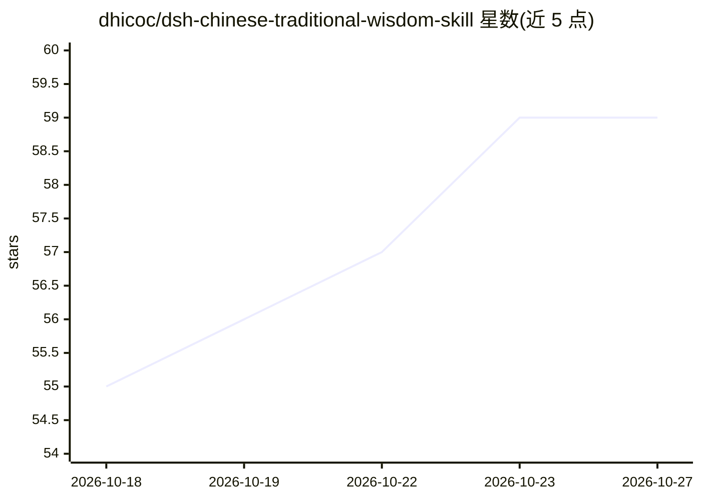

# dhicoc/dsh-chinese-traditional-wisdom-skill

⭐ 59 · TypeScript · 推送 2026-10-08 · [GitHub](https://github.com/dhicoc/dsh-chinese-traditional-wisdom-skill) · 个人维护 · 中文 README

**给 dsh 用户的中华传统智慧咨询插件：八字/紫微/六爻等本地排盘**

DeepSeek Harness（dsh）的 Cordis 插件，将「玄枢」中华传统智慧 Skill 打包进 dsh 对话：用户用自然语言提问，Agent 按 SKILL.md 路由调用本地确定性 TypeScript 引擎完成排盘与推演，覆盖八字、紫微、六爻、梅花、奇门、风水、五运六气、体质等，输出分「本地计算事实/文化解释/行动建议/免责声明」四层，附 24 工作区 Dashboard。含 32 个本地 CLI 工具，生辰不上传远端。一行 dsh plugin add 安装，明确声明不构成医疗/投资建议。

## 筛选速览

| 维度 | 判定 | 备注 |
|---|---|---|
| AI 角色 | `ai-native` | 本体是模型或模型工具 |
| 许可风险 | `none` | — |
| 部署形态 | `library` | 以包/库形式分发 |
| 模型依赖 | locked-api |  |
| 硬件要求 | — | 无带数字的原话,不猜 |
| 安装摩擦 | `low` | 无编译、无系统依赖或容器化 |
| 成熟度 | — | 结构信号不足 |

## 能力要点

- 本地 TypeScript 确定性引擎完成排盘推演，模型不自行补全干支/数值
- 命理/占测/历法/风水/体质等 10 余类能力，32 个本地 CLI 工具
- 输出四层区分：计算事实/文化解释/行动建议/免责声明
- 24 工作区本地 Dashboard 可视化浏览盘面

## 适用场景

- 在 dsh 对话中排八字、紫微、六爻等盘面并获得分层解释
- 查每日黄历宜忌、流年飞星等日用信息
- 按九种体质问卷获取健康文化参考（不替代就医）

## 场景标签

 · 领域:传统文化/命理占卜 AI 工具

## 证据(README 行号)

> L15: 本仓库是一个 **dsh Cordis 插件**（由 `skill2dsh` 生成），它把 Skill `chinese-traditional-wisdom-ai-agent-workflow`（产品名 **玄枢**）原样打包进
> L19: - 核心计算（八字、紫微、六爻、梅花、奇门、大六壬、太乙、五运六气、体质、风水、姓名等）在**本地纯 TypeScript 引擎**中运行，不把完整生辰上传到远端。

## 星数曲线

2026-10-18 55 → 2026-10-27 59（+4）

---
*卡片 v1 · prompt 1.4 · 生成 2026-10-24 · 置信度 mid · 依据 README sha `dac5f84e6c1e` · [字段定义](../../DATASET.md)*
