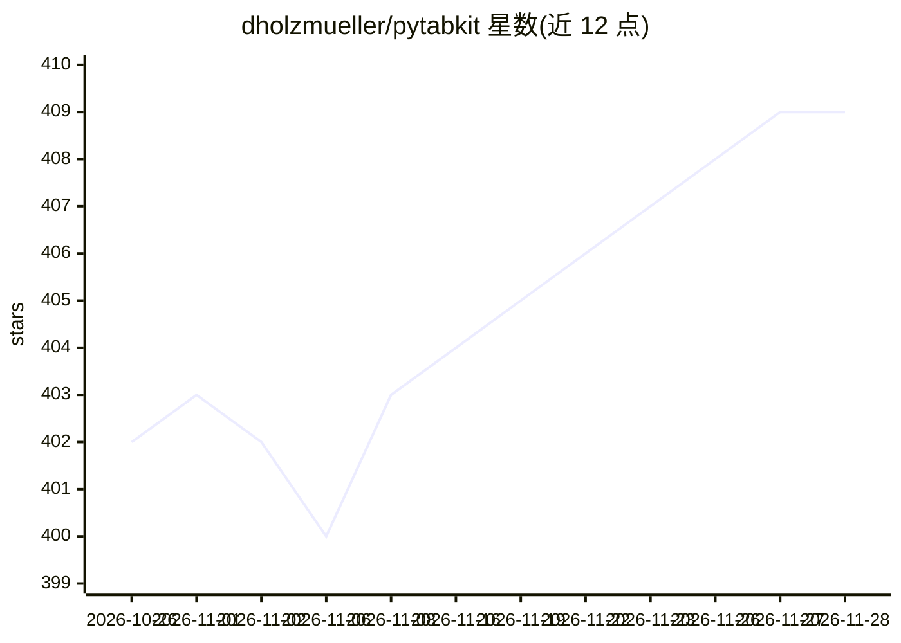

# dholzmueller/pytabkit

⭐ 409 · Python · Apache-2.0 · 推送 2026-11-01 · [GitHub](https://github.com/dholzmueller/pytabkit) · 组织维护

**面向表格数据分类回归的现代 ML 模型与基准库**

提供经论文基准测试的表格分类/回归方法的 scikit-learn 接口，并附基准测试代码。模型含 RealMLP、TabM、TabR、xRFM 及 XGBoost/LightGBM/CatBoost 接口，支持 D/TD/HPO/Ensemble 变体、向量交叉验证加速、后校准与精炼停止。通过 pip 安装；基准代码支持数据下载、单/多节点多 GPU 并行调度与结果分析。限制：缺失数值需预先插补，方法评估场景推荐 TabArena。

## 筛选速览

| 维度 | 判定 | 备注 |
|---|---|---|
| AI 角色 | `ai-native` | 本体是模型或模型工具 |
| 许可风险 | `permissive` | Apache-2.0 |
| 部署形态 | `library` | 以包/库形式分发 |
| 模型依赖 | — | README 未给出锁定关系 |
| 硬件要求 | — | 无带数字的原话,不猜 |
| 安装摩擦 | `medium` | 含编译或系统依赖之一 |
| 成熟度 | — | 结构信号不足 |

## 能力要点

- RealMLP/TabM/TabR/xRFM 等表格模型的 scikit-learn 接口
- 向量交叉验证加速 RealMLP 训练，自动选择 GPU 与类别列检测
- 基准代码支持多节点/多 GPU 并行调度与 RAM 约束
- 内置 few-shot 基准（TabICLv2 论文，16 样本训练）

## 适用场景

- 对表格数据做分类或回归建模，开箱即用调优默认参数
- 为表格 ML 方法开发做快速基准对比
- 复现 NeurIPS 2024 论文及 TabICLv2 few-shot 实验

## 场景标签

`模型评测` · 领域:评测与运维

## 证据(README 行号)

> L11: PyTabKit provides **scikit-learn interfaces for modern tabular classification and regression methods**
> L13: It also contains the code we used for **benchmarking** these methods
> L73: Most of our machine learning models are directly available via scikit-learn interfaces.

## 星数曲线

2026-10-26 402 → 2026-11-28 409（+7）

---
*卡片 v1 · prompt 1.4 · 生成 2026-11-25 · 置信度 high · 依据 README sha `6ac2a3b9347e` · [字段定义](../../DATASET.md)*
