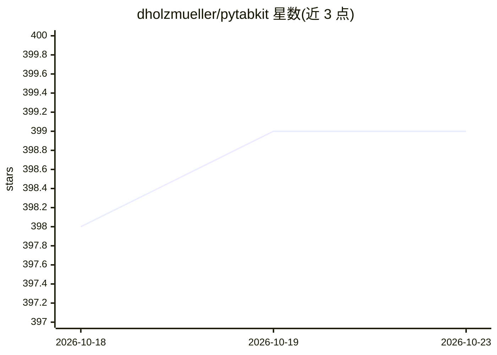

# dholzmueller/pytabkit

⭐ 399 · Python · Apache-2.0 · 推送 2026-01-06 · [GitHub](https://github.com/dholzmueller/pytabkit) · 个人维护

**表格数据分类/回归的 scikit-learn 接口模型库与基准代码**

为使用 scikit-learn 工具链的开发者与科研人员提供表格数据分类与回归模型：包含作者论文中的 RealMLP 神经网络模型、TabM、TabR、xRFM，以及 XGBoost/LightGBM/CatBoost 的接口，均有库默认(D)、调优默认(TD)、随机搜索超参优化(HPO)等变体。附基准测试代码，支持数据集下载、单/多节点多 GPU 并行调度与结果分析。通过 pip 安装，RealMLP 可无附加依赖使用，部分模型需可选依赖；缺失数值需先填补。

## 筛选速览

| 维度 | 判定 | 备注 |
|---|---|---|
| AI 角色 | `ai-native` | 本体是模型或模型工具 |
| 许可风险 | `permissive` | Apache-2.0 |
| 部署形态 | `library` | 以包/库形式分发 |
| 模型依赖 | — | README 未给出锁定关系 |
| 硬件要求 | — | 无带数字的原话,不猜 |
| 安装摩擦 | `medium` | 含编译或系统依赖之一 |
| 成熟度 | — | 结构信号不足 |

## 能力要点

- RealMLP 等 10 余种表格模型提供 scikit-learn 接口（D/TD/HPO 变体）
- 自动 GPU 检测、类别列检测、数值与回归目标预处理、早停
- 向量化交叉验证与 Caruana 加权集成、事后温度缩放校准
- 基准代码支持多节点多 GPU 并行调度与结果分析

## 适用场景

- 在 scikit-learn 流水线中直接使用 RealMLP/TabM 做表格分类回归
- 复现或运行论文中的表格数据基准实验
- 对比调优默认(TD)与超参搜索(HPO)配置的效果

## 场景标签

`模型评测` · 领域:评测与运维

## 证据(README 行号)

> L11: PyTabKit provides **scikit-learn interfaces for modern tabular classification and regression methods**
> L73: model = RealMLP_TD_Classifier()  # or TabR_S_D_Classifier, CatBoost_TD_Classifier, etc.
> L75: model.predict(X_test)

## 星数曲线

2026-10-18 398 → 2026-10-23 399（+1）

---
*卡片 v1 · prompt 1.4 · 生成 2026-10-21 · 置信度 high · 依据 README sha `1dc6fe12cf42` · [字段定义](../../DATASET.md)*
