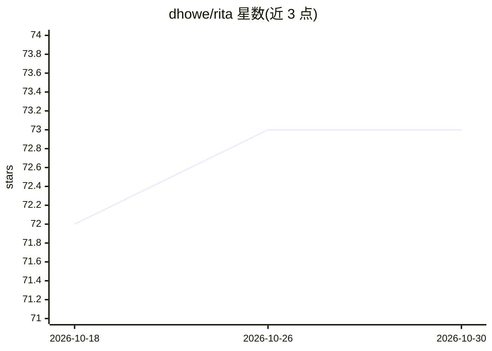

# dhowe/rita

⭐ 73 · Python · 推送 2026-10-25 · [GitHub](https://github.com/dhowe/rita) · [官网](https://rednoise.org/rita) · 个人维护

**面向写作者的生成式自然语言工具库（Java/JavaScript）**

RiTa 是以 Java 和 JavaScript 双实现、共享统一 API 的自然语言工具库，采用 GPL 许可。提供无限 N 元语法（N-gram）的 Markov 生成器、基于词性/音节/重音/押韵模式的词典检索、词形变化与词干提取等启发式算法、任意词的字母转语音引擎，以及面向写作者的 RiScript 脚本语言，可通过文法与 Markov 链生成文本。项目自述 100% AI-free（不依赖 AI 模型）。本仓库为其网站、文档与示例。

## 筛选速览

| 维度 | 判定 | 备注 |
|---|---|---|
| AI 角色 | `ai-native` | 本体是模型或模型工具 |
| 许可风险 | `none` | — |
| 部署形态 | `None` |  |
| 模型依赖 | — | README 未给出锁定关系 |
| 硬件要求 | — | 无带数字的原话,不猜 |
| 安装摩擦 | `low` | 无编译、无系统依赖或容器化 |
| 成熟度 | — | 结构信号不足 |

## 能力要点

- Java/JavaScript 双实现共享统一 API，GPL 开源
- 支持无限 N-gram 的 Markov 生成器
- 按词性/音节/重音/押韵模式检索词典
- 集成面向写作者的 RiScript 脚本语言（可运行时动态展开）

## 适用场景

- 生成式文学与文字艺术创作
- 英语词汇分析：押韵、音节、词性、词形变化
- 用文法与 Markov 链构建文本生成程序

## 场景标签

`AI 写作` · 领域:内容生成

## 证据(README 行号)

> L3: ## RiTa: tools for generative natural language
> L9: * A complete rewrite of the Markov generator, efficiently employing unbounded (infinite) N-grams.
> L15: * 100% AI-free

## 星数曲线

2026-10-18 72 → 2026-10-30 73（+1）

---
*卡片 v1 · prompt 1.4 · 生成 2026-10-24 · 置信度 mid · 依据 README sha `77a0257fed94` · [字段定义](../../DATASET.md)*
