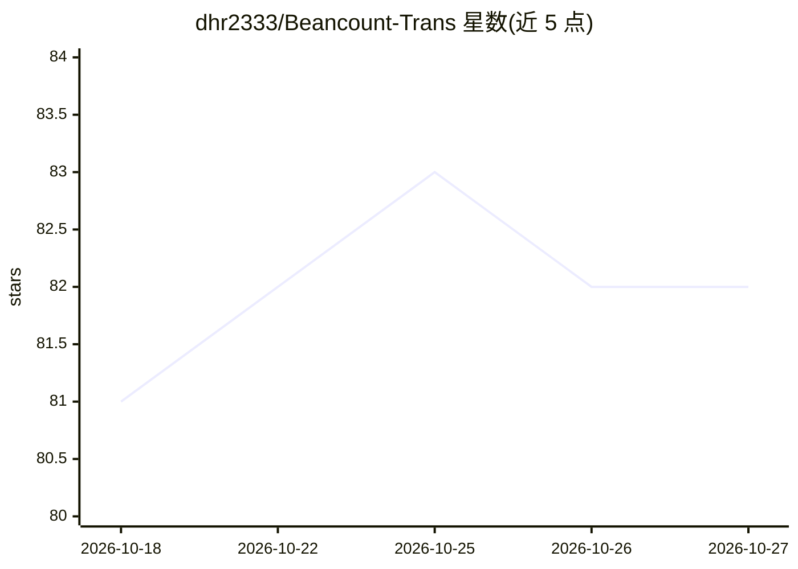

# dhr2333/Beancount-Trans

⭐ 82 · TypeScript · MIT · 推送 2026-10-23 · [GitHub](https://github.com/dhr2333/Beancount-Trans) · [官网](https://trans.dhr2333.cn/) · 个人维护 · 中文 README

**上传账单自动转为可审计 Beancount 记账数据并出报表**

面向复式记账用户的账单转换工具：上传支付宝、微信等账单文件，自动解析并分类为 Beancount 格式的记账数据，随后生成财务报表。分类在本地由预下载的 bert-base-chinese 模型完成，不经外部大模型；解析页不保留上传文件。提供云端平台与自托管两种使用方式，自托管通过 git clone、拉取模型仓库并 docker compose 启动，默认端口 38001，含默认账号 admin/123456。已被 Awesome Beancount 收录。

## 筛选速览

| 维度 | 判定 | 备注 |
|---|---|---|
| AI 角色 | `ai-enhanced` | 去掉 AI 部分产品仍成立 |
| 许可风险 | `permissive` | MIT |
| 部署形态 | `self-host` | docker 或自建部署 |
| 模型依赖 | — | README 未给出锁定关系 |
| 硬件要求 | — | 无带数字的原话,不猜 |
| 安装摩擦 | `low` | 无编译、无系统依赖或容器化 |
| 成熟度 | — | 结构信号不足 |

## 能力要点

- 账单自动解析并转换为 Beancount 复式记账数据
- 分类在本地由 BERT 模型完成，不经大模型，上传文件不保留
- 支持云平台与 Docker 自托管两种部署方式
- 转换后几分钟内查看与分析财务报表

## 适用场景

- 把支付宝/微信等账单批量转为 Beancount 记账
- 本地自托管处理账单，避免隐私数据外发
- 快速生成个人财务报表进行分析

## 场景标签

`文档解析` · 领域:知识与检索

## 证据(README 行号)

> L9: **上传账单，自动转换为可审计的 Beancount 复式记账数据，并在几分钟内分析财务报表**。
> L15: 解析页不保留上传文件；分类在本地完成，不经大模型，无需担心账单隐私。
> L39: git clone https://huggingface.co/google-bert/bert-base-chinese ./Beancount-Trans-Backend/pretrained_models/bert-bas

## 星数曲线

2026-10-18 81 → 2026-10-27 82（+1）

---
*卡片 v1 · prompt 1.4 · 生成 2026-10-24 · 置信度 mid · 依据 README sha `a07214e52944` · [字段定义](../../DATASET.md)*
