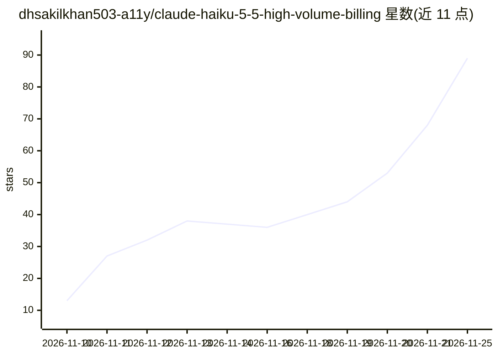

# dhsakilkhan503-a11y/claude-haiku-5-5-high-volume-billing

⭐ 89 · 推送 2026-11-09 · [GitHub](https://github.com/dhsakilkhan503-a11y/claude-haiku-5-5-high-volume-billing) · [官网](https://app.coregold.io/signup?invite_code=ADvlj9b) · 个人维护 · 中文 README

**面向 Claude Haiku 5.5 高频扣费用户的 CoreGold 虚拟卡推广指南**

内容为一份图文指南，说明 Claude Haiku 5.5 大并发调用时 Anthropic Console 高频小额扣款易触发亚太个人卡风控的问题，随后介绍 CoreGold 企业商用卡段的清算放行机制，并给出入金（USDT 转 USD）、派发业务专卡、绑卡使用三步实施流程，末尾附开卡控制台入口与识别码。仓库不含任何代码、安装命令或可运行软件，实质为 CoreGold 卡服务的引导性内容，主题标签含 coregold。

## 筛选速览

| 维度 | 判定 | 备注 |
|---|---|---|
| AI 角色 | `ai-knowledge` | 知识聚合/清单类 |
| 许可风险 | `none` | — |
| 部署形态 | `None` |  |
| 模型依赖 | — | README 未给出锁定关系 |
| 硬件要求 | — | 无带数字的原话,不猜 |
| 安装摩擦 | `low` | 无编译、无系统依赖或容器化 |
| 成熟度 | — | 结构信号不足 |

## 能力要点

- 描述 Claude Haiku 5.5 高并发下的高频小额结算特征
- 给出 CoreGold 三步用卡流程（入金/派发专卡/绑卡）
- 无代码、无安装方式，仅文档

## 适用场景

- 了解 Claude API 高频扣款触发银行卡风控的叙述
- 按文档指引开通 CoreGold 商业卡段

## 场景标签

 · 领域:AI 服务支付/推广

## 证据(README 行号)

> L24: 1. **入金**：进入 CoreGold 控制台，充入 USDT 转换为 USD 资金池。
> L28: 👉 **立即进入 CoreGold 开卡控制台**
> L29: c28dd360c64acb853905521a9fad6181

## 星数曲线

2026-11-10 13 → 2026-11-25 89（+76）

---
*卡片 v1 · prompt 1.4 · 生成 2026-11-18 · 置信度 high · 依据 README sha `7b57009a41d3` · [字段定义](../../DATASET.md)*
