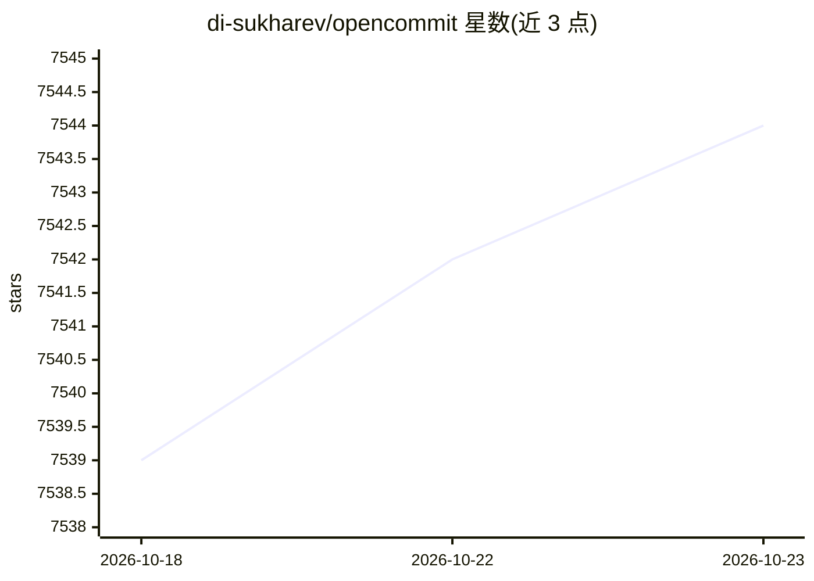

# di-sukharev/opencommit

⭐ 7,544 · JavaScript · MIT · 推送 2026-10-13 · [GitHub](https://github.com/di-sukharev/opencommit) · [官网](https://www.npmjs.com/package/opencommit) · 个人维护

**用 LLM 为 git 暂存改动自动生成提交信息的 CLI 工具**

以 `oco` 命令运行的 npm CLI 工具：读取 git 暂存改动，调用 LLM 生成符合 Conventional Commit 规范的提交信息并完成提交。支持 OpenAI（默认 gpt-4o-mini）、Anthropic、Azure、Gemini、DeepSeek、OpenRouter 等多种云端 provider，也可通过 Ollama 或 llama.cpp 在本地运行（llama3:8b/mistral 等）。可配置 emoji 前缀、生成语言、 WHY 说明、commitlint 提示模块、代理与消息模板；API key 与配置存于 ~/.opencommit。注意：push 提示功能标注了“gonna be deprecated”。

## 筛选速览

| 维度 | 判定 | 备注 |
|---|---|---|
| AI 角色 | `ai-native` | 本体是模型或模型工具 |
| 许可风险 | `permissive` | MIT |
| 部署形态 | `library` | 以包/库形式分发 |
| 模型依赖 | local-ok | 支持本地模型 |
| 硬件要求 | — | 无带数字的原话,不猜 |
| 安装摩擦 | `low` | 无编译、无系统依赖或容器化 |
| 成熟度 | — | 结构信号不足 |

## 能力要点

- git add 后一条 `oco` 命令生成并提交 commit message
- 支持本地 Ollama / llama.cpp 及十余种云端 LLM provider
- emoji、生成语言、conventional-commit/commitlint 模块均可配置
- 支持 `oco models` 拉取并缓存 provider 可用模型列表

## 适用场景

- 日常开发中快速生成规范的 commit message
- 在离线或内网环境用 Ollama/llama.cpp 本地模型生成提交信息
- 统一团队提交信息的语言与 Conventional Commit 格式

## 场景标签

`AI 写作` · 领域:内容生成

## 证据(README 行号)

> L5:  Auto-generate meaningful commits in a second
> L36: You can call OpenCommit with `oco` command to generate a commit message for your staged changes:
> L137: OCO_AI_PROVIDER=<openai (default), anthropic, azure, ollama, llamacpp, gemini, flowise, deepseek, aimlapi, openrou

## 星数曲线

2026-10-18 7,539 → 2026-10-23 7,544（+5）

---
*卡片 v1 · prompt 1.4 · 生成 2026-10-20 · 置信度 high · 依据 README sha `fe12e24fd66b` · [字段定义](../../DATASET.md)*
