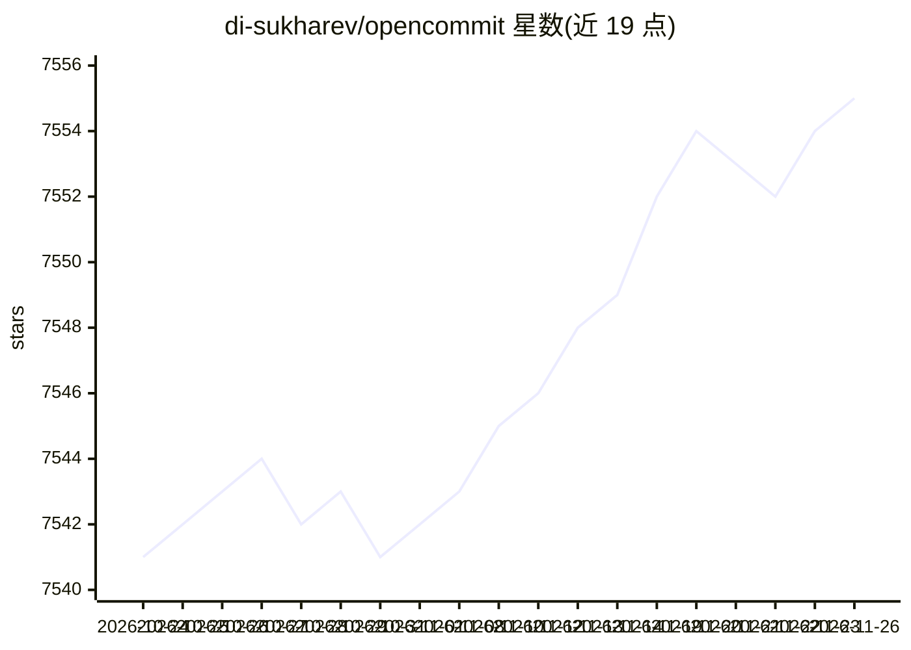

# di-sukharev/opencommit

⭐ 7,555 · JavaScript · MIT · 推送 2026-11-21 · [GitHub](https://github.com/di-sukharev/opencommit) · [官网](https://www.npmjs.com/package/opencommit) · 个人维护

**CLI 工具：为 git 暂存改动自动生成 commit message**

OpenCommit 是以 `oco` 命令运行的 CLI 工具，读取 git 暂存区改动并调用 LLM 生成符合 Conventional Commit / GitMoji 规范的提交信息，支持 emoji 前缀、长描述、跳过确认等可配置项。默认使用 OpenAI gpt-4o-mini，可切换到 Anthropic、Azure、Gemini、DeepSeek、OpenRouter 等云提供商，也可通过 Ollama 或 llama.cpp 调用本地模型，支持远程端点与自定义 API URL。提供全局与按仓库两级配置（~/.opencommit 与 .env）、`oco models` 模型管理（缓存 7 天）。需要自行配置提供商 API key；OCO_WHY 功能标注为 WIP。

## 筛选速览

| 维度 | 判定 | 备注 |
|---|---|---|
| AI 角色 | `ai-native` | 本体是模型或模型工具 |
| 许可风险 | `permissive` | MIT |
| 部署形态 | `library` | 以包/库形式分发 |
| 模型依赖 | local-ok | 支持本地模型 |
| 硬件要求 | — | 无带数字的原话,不猜 |
| 安装摩擦 | `low` | 无编译、无系统依赖或容器化 |
| 成熟度 | — | 结构信号不足 |

## 能力要点

- 一条 `oco` 命令为暂存改动生成 commit message
- 支持 OpenAI/Anthropic/Azure/Gemini/DeepSeek/OpenRouter 等多种云提供商与多个 OpenAI 兼容网关
- 支持 Ollama 与 llama.cpp 本地模型，可配置远程 GPU 端点
- GitMoji 规范、emoji 位置、跳过确认等均可配置

## 适用场景

- 日常开发中替代手写 commit message
- 统一团队提交信息的 Conventional Commit / GitMoji 格式
- 离线或私有环境下用本地模型生成提交信息

## 场景标签

`代码生成` · 领域:编码与开发

## 证据(README 行号)

> L5:  Auto-generate meaningful commits in a second
> L16: You can use OpenCommit by simply running it via the CLI like this `oco`. 2 seconds and your staged changes are comm
> L36: You can call OpenCommit with `oco` command to generate a commit message for your staged changes:

## 星数曲线

2026-10-24 7,541 → 2026-11-26 7,555（+14）

---
*卡片 v1 · prompt 1.4 · 生成 2026-11-22 · 置信度 high · 依据 README sha `a581efc6233c` · [字段定义](../../DATASET.md)*
