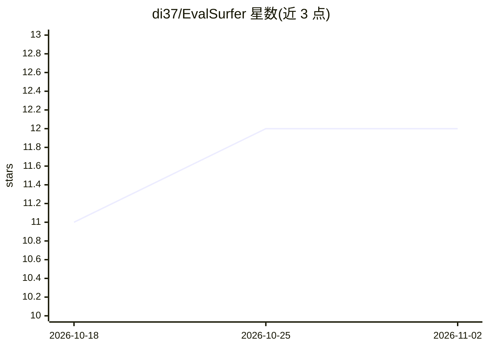

# di37/EvalSurfer

⭐ 12 · Python · MIT · 推送 2026-07-15 · [GitHub](https://github.com/di37/EvalSurfer) · 个人维护

**AI 应用评测框架：由用户已有 agent 担任评审，框架提供确定性度量工具**

基于 CIMAA 五层架构（Core/Interface/Metrics/Analysis/Assurance）的 agent 原生 AI 评测框架。用户将回答、RAG 运行、agent 轨迹或生产日志交给已在运行的编码 agent（Claude Code、Cursor、OpenClaw 等）评审，agent 按 SKILL.md 的固定量表打分，并调用 49 个确定性 MCP 工具做度量；框架自身零 LLM API 调用，无需额外 API key 或服务。输出类别/总体分数与 pass/pass with fixes/fail 决策，可用作 CI 门禁。以 PyPI/npm 包、可移植技能文件和 CLI 提供。

## 筛选速览

| 维度 | 判定 | 备注 |
|---|---|---|
| AI 角色 | `ai-ecosystem` | LLM/agent 周边工具 |
| 许可风险 | `permissive` | MIT |
| 部署形态 | `library` | 以包/库形式分发 |
| 模型依赖 | — | README 未给出锁定关系 |
| 硬件要求 | — | 无带数字的原话,不猜 |
| 安装摩擦 | `low` | 无编译、无系统依赖或容器化 |
| 成熟度 | — | 结构信号不足 |

## 能力要点

- 框架自身零 LLM 调用，评审由用户已有编码 agent 担任
- 49 个确定性 MCP 工具覆盖规划、打分、验证、诊断、校准与门禁
- CIMAA 五层架构：Core/Interface/Metrics/Analysis/Assurance
- 可移植 SKILL.md 兼容 Claude Code/Cursor/OpenClaw/Hermes 等多 harness

## 适用场景

- 让编码 agent 评审 RAG 回答或 agent 轨迹并给出发布决策
- 在 CI 流程中把评测决策作为发布门禁
- 度量延迟、成本、Recall@k、BLEU 等运行与参考指标

## 场景标签

`模型评测` · 领域:评测与运维

## 证据(README 行号)

> L16: > **EvalSurfer is an agent-native evaluation framework. The coding agent you're already running is the judge; EvalS
> L41: |**I — Interface**|Connect users, agents, APIs, and external tools to the system.|The portable agent skill, the 49-

## 星数曲线

2026-10-18 11 → 2026-11-02 12（+1）

---
*卡片 v1 · prompt 1.4 · 生成 2026-11-01 · 置信度 high · 依据 README sha `1586ebe8c0ed` · [字段定义](../../DATASET.md)*
