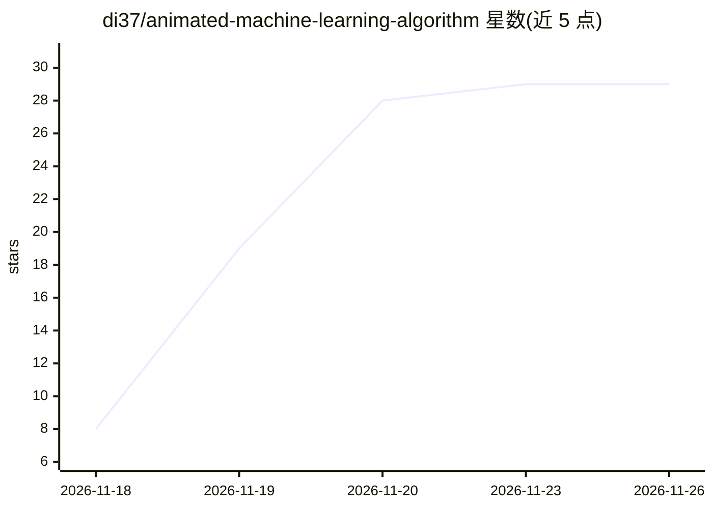

# di37/animated-machine-learning-algorithm

⭐ 29 · Python · 推送 2026-11-17 · [GitHub](https://github.com/di37/animated-machine-learning-algorithm) · [官网](https://di37.github.io/animated-machine-learning-algorithm/) · 个人维护

**面向 ML 学习者：动画展示 scikit-learn 模型真实训练与预测过程的教学视频集**

以 76 个视频可视化 21 个 scikit-learn 模型在两个经典数据集（California Housing 回归、Titanic 分类）上的完整生命周期：数据→首次猜测→训练→推理→测试。每帧为真实模型状态快照，推理讲解用模型自身参数（coef_、tree_、support_vectors_ 等）逐步演算，并须与 model.predict 结果一致才显示。含 9 秒时间-lapse 讲解课与 Manim 版本，一条命令可复现任意视频。

## 筛选速览

| 维度 | 判定 | 备注 |
|---|---|---|
| AI 角色 | `ai-knowledge` | 知识聚合/清单类 |
| 许可风险 | `none` | — |
| 部署形态 | `library` | 以包/库形式分发 |
| 模型依赖 | — | README 未给出锁定关系 |
| 硬件要求 | — | 无带数字的原话,不猜 |
| 安装摩擦 | `medium` | 含编译或系统依赖之一 |
| 成熟度 | — | 结构信号不足 |

## 能力要点

- 76 个视频覆盖 21 个模型 × 训练与推理两阶段
- 每帧为真实训练快照，讲解方程须与 model.predict 输出精确吻合
- 模型内部参数直接读取自拟合后的 estimator，非事后近似
- 开源可复现：一条命令重新生成任意视频，并有测试守护

## 适用场景

- 学习机器学习算法时建立直观理解
- 数据科学面试前可视化记忆 20+ 算法行为
- 教育者使用现成的 108 秒无声可懂讲解课
- 向利益相关者解释单个预测为何得出

## 场景标签

`教程课程` · 领域:学习与行业

## 证据(README 行号)

> L7:  76 videos
> L20: > 🔍 **The black box, opened.** Watch scikit-learn models **learn** two classic datasets, frame by frame, then
> L62: |🌱 **An ML enthusiast or student**|Intuition that formulas alone don't give: why a deep tree over-fits, why boostin

## 星数曲线

2026-11-18 8 → 2026-11-26 29（+21）

---
*卡片 v1 · prompt 1.4 · 生成 2026-11-19 · 置信度 mid · 依据 README sha `9125f9d705e2` · [字段定义](../../DATASET.md)*
