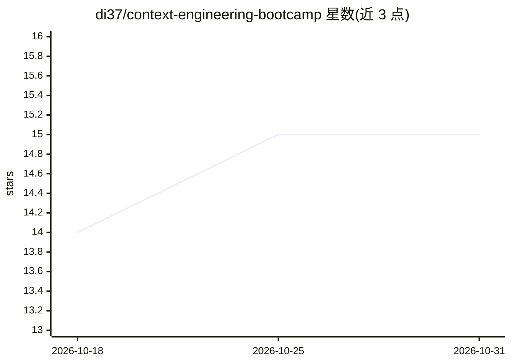

# di37/context-engineering-bootcamp

⭐ 15 · Typst · 推送 2026-04-25 · [GitHub](https://github.com/di37/context-engineering-bootcamp) · 个人维护

**LLM 上下文工程学习笔记库：RAG/系统提示/MCP/Agent/记忆**

由个人维护的 LLM 上下文工程结构化学习资料库，主体整理自 Vizuara AI Lab 的 Context Engineering Bootcamp 课程，并补充教程、论文与社区资源。内容按 7 个 Session 组织，覆盖系统提示与 CLAUDE.md、RAG 流水线、MCP 与 Agent 循环、上下文失效模式、多 Agent 上下文管理与记忆管理等主题。笔记以 PDF 与 Typst 源码两种格式提供，部分章节标注仍在编写中。

## 筛选速览

| 维度 | 判定 | 备注 |
|---|---|---|
| AI 角色 | `ai-knowledge` | 知识聚合/清单类 |
| 许可风险 | `none` | — |
| 部署形态 | `None` |  |
| 模型依赖 | — | README 未给出锁定关系 |
| 硬件要求 | — | 无带数字的原话,不猜 |
| 安装摩擦 | `low` | 无编译、无系统依赖或容器化 |
| 成熟度 | `idea` | |

## 能力要点

- 7 个 Session 覆盖 RAG、MCP、Agent、记忆管理等上下文工程主题
- 笔记同时提供 PDF 与 Typst 源码两种格式
- 汇总多个专家来源：课程、教程、论文与社区资源

## 适用场景

- 系统学习 LLM 上下文工程的知识体系
- 查阅 RAG 流水线与上下文失效模式的参考资料
- 获取可自行编译修改的 Typst 笔记源码

## 场景标签

`教程课程` · 领域:学习与行业

## 证据(README 行号)

> L3: Comprehensive notes and visual resources on LLM context engineering, compiled from multiple sources. The primary res
> L7: Context engineering is the discipline of designing, assembling, and managing everything that flows into a large lang

## 星数曲线

2026-10-18 14 → 2026-10-31 15（+1）

---
*卡片 v1 · prompt 1.4 · 生成 2026-10-30 · 置信度 high · 依据 README sha `c7853d780326` · [字段定义](../../DATASET.md)*
