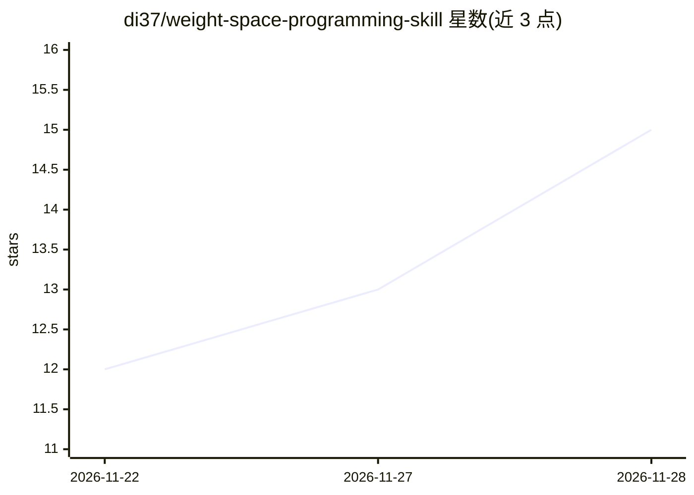

# di37/weight-space-programming-skill

⭐ 15 · Python · MIT · 推送 2026-11-21 · [GitHub](https://github.com/di37/weight-space-programming-skill) · 个人维护

**Claude Code 技能：不改训练直接编辑小模型权重以改进行为**

一个安装在 Claude Code 中的技能，通过对开源 LLM 权重做 rank-1 编辑来移除特定行为（如思考循环、吹捧性开头）或改变输出属性，全程无需训练。流程包括：定位待移除行为、用前向传播计算分离方向、在模型磁盘副本上写入编辑、用随机对照筛选候选、在保留题上做配对检验并给出结论。预设数学（MATH-500）、科学（MMLU-Pro）及三项视觉任务；按机器选择 vllm/mlx-lm/transformers 作为生成引擎。README 报告的结果样本量小且自述存在统计不确定性。

## 筛选速览

| 维度 | 判定 | 备注 |
|---|---|---|
| AI 角色 | `ai-ecosystem` | LLM/agent 周边工具 |
| 许可风险 | `permissive` | MIT |
| 部署形态 | `library` | 以包/库形式分发 |
| 模型依赖 | local-ok | 支持本地模型 |
| 硬件要求 | — | 无带数字的原话,不猜 |
| 安装摩擦 | `low` | 无编译、无系统依赖或容器化 |
| 成熟度 | — | 结构信号不足 |

## 能力要点

- rank-1 权重编辑流程 W' = W − α·u(uᵀW)，写入模型磁盘副本
- 自动或以配对样本定位待移除行为（循环、吹捧等）
- 随机对照筛选 + 保留题配对检验 + 失败逐级回退与恢复副本
- 内置数学/科学/图像任务预设，其他目标可用自定义提示与评分器

## 适用场景

- 移除小模型在推理中陷入的重复循环
- 让模型按提问语言回答或改变输出格式、冗长度等属性
- 复现论文中的权重空间编程实验

## 场景标签

 · 领域:LLM 可解释性/模型编辑

## 证据(README 行号)

> L3: A Claude Code skill that makes a small open LLM better at a goal by **editing its
> L31: Clone it into your Claude Code skills folder: user-wide (`~/.claude/skills/`) or per project (`.claude/skills/`).

## 星数曲线

2026-11-22 12 → 2026-11-28 15（+3）

---
*卡片 v1 · prompt 1.4 · 生成 2026-11-22 · 置信度 high · 依据 README sha `7a64e6da1787` · [字段定义](../../DATASET.md)*
