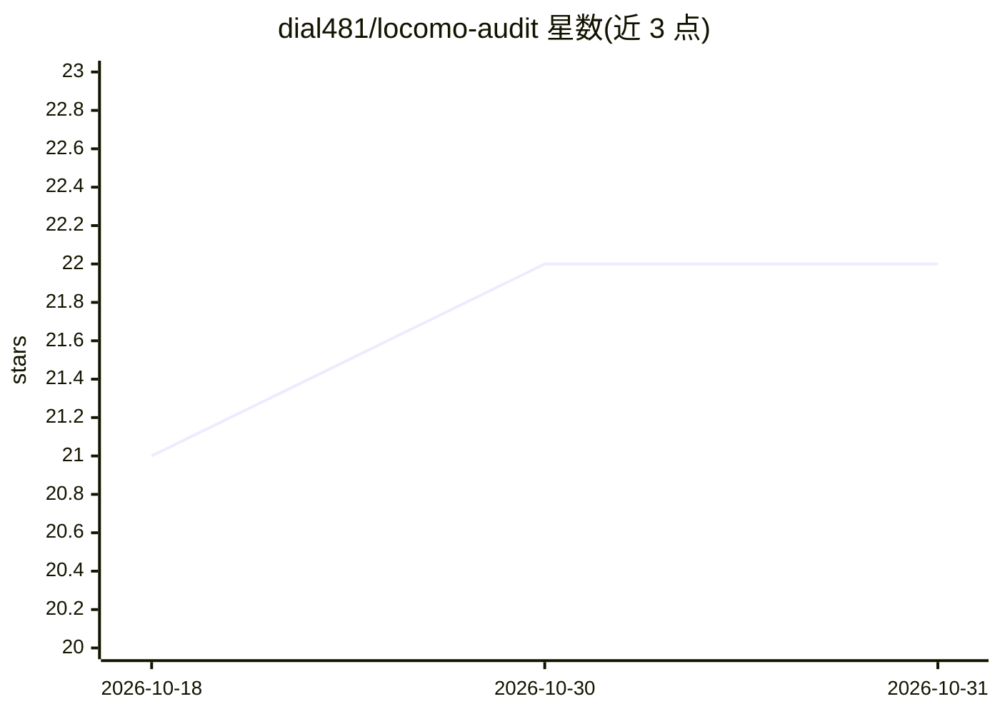

# dial481/locomo-audit

⭐ 22 · Python · NOASSERTION · 推送 2026-04-02 · [GitHub](https://github.com/dial481/locomo-audit) · [官网](https://github.com/snap-research/locomo/) · 个人维护

**对 LoCoMo 长上下文基准与 EverMemOS 评测的独立审计报告**

独立审计仓库，检视 LoCoMo 基准数据集与 EverMemOS 评测框架：发现 1,540 题中 99 题（6.4%）金标准答案错误、理论得分上限为 93.57%；报告各类别样本量差异导致的统计不可区分性、token 成本与论文数据不符（声称 2,298 vs 论文表 8 的 6,669）、LLM 评审接受 62.81% 的故意错误答案、第三方复现仅得 38.38% vs 声称 92.32%。每条结论链接可验证原始来源，附带 SHA256 校验脚本与来源许可清单。面向基准使用者与评测研究人员。

## 筛选速览

| 维度 | 判定 | 备注 |
|---|---|---|
| AI 角色 | `ai-knowledge` | 知识聚合/清单类 |
| 许可风险 | `none` | NOASSERTION |
| 部署形态 | `None` |  |
| 模型依赖 | — | README 未给出锁定关系 |
| 硬件要求 | — | 无带数字的原话,不猜 |
| 安装摩擦 | `low` | 无编译、无系统依赖或容器化 |
| 成熟度 | — | 结构信号不足 |

## 能力要点

- 系统审计发现 156 个问题：99 个影响得分、57 个仅涉引用
- 数据集与评测配置文件提供 SHA256 校验与第三方许可声明
- 覆盖统计有效性、token 成本、评审宽容度与复现失败四类证据
- 发现 446 道对抗性问题（占 22.5%）从未被已发表结果评估

## 适用场景

- 引用 LoCoMo 分数前核查基准的数据与统计有效性
- 复核 EverMemOS 等记忆系统的评测方法与 token 成本口径
- 设计长上下文评测时参考已知的基准缺陷清单

## 场景标签

`模型评测` · 领域:评测与运维

## 证据(README 行号)

> L3: Independent audit of the LoCoMo (Long-Context Modeling) benchmark and the EverMemOS evaluation framework. Findings c
> L9: |Ground truth errors|99 of 1,540 questions (6.4%) have wrong golden answers. Theoretical scoring ceiling is 93.57%.|

## 星数曲线

2026-10-18 21 → 2026-10-31 22（+1）

---
*卡片 v1 · prompt 1.4 · 生成 2026-10-28 · 置信度 high · 依据 README sha `67be242f44d8` · [字段定义](../../DATASET.md)*
