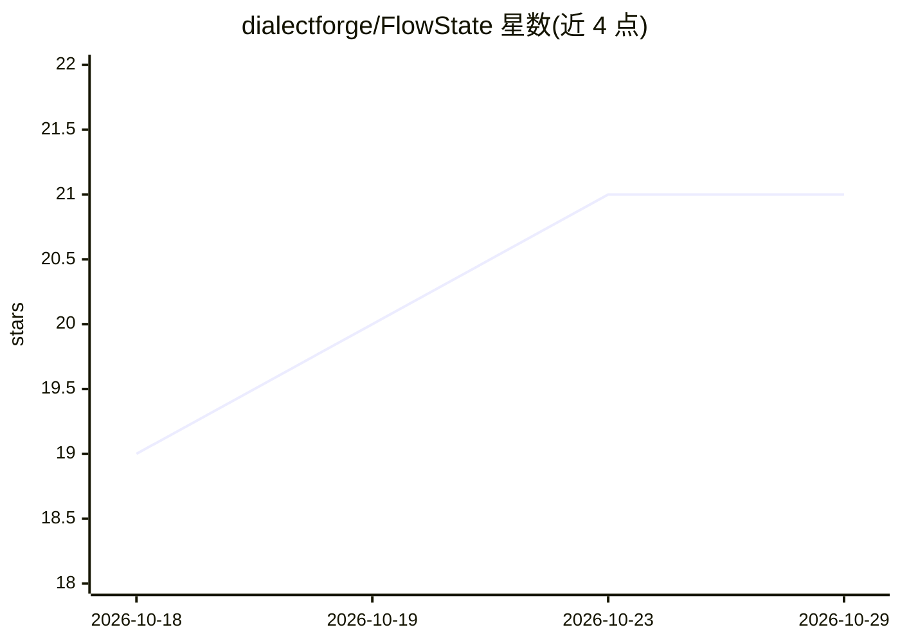

# dialectforge/FlowState

⭐ 21 · Python · MIT · 推送 2026-10-25 · [GitHub](https://github.com/dialectforge/FlowState) · 个人维护

**本地优先的跨 AI 应用共享项目记忆 MCP 服务器**

本地运行的 MCP 服务器，为 Claude、ChatGPT、Cursor、Grok 等多个 AI 应用提供同一份项目记忆：待办、变更、决策、问题与经验。AI 开始工作时读取 start_here 简报（quick/standard/deep 三档），用 log_work 记录过程，下一个会话或另一个应用可接着继续。数据存于本机单个 SQLite 文件，默认不外发；提供可选的私有 GitHub 异地备份、Cloudflare Tunnel 远程访问与 relay。含多 agent 待办认领、冲突检测与人工审核队列机制。需 Python 3.11+，通过 setup_flowstate.py 或手动 git clone 安装。

## 筛选速览

| 维度 | 判定 | 备注 |
|---|---|---|
| AI 角色 | `ai-ecosystem` | LLM/agent 周边工具 |
| 许可风险 | `permissive` | MIT |
| 部署形态 | `library` | 以包/库形式分发 |
| 模型依赖 | — | README 未给出锁定关系 |
| 硬件要求 | — | 无带数字的原话,不猜 |
| 安装摩擦 | `low` | 无编译、无系统依赖或容器化 |
| 成熟度 | — | 结构信号不足 |

## 能力要点

- 多个 AI 应用共享同一 SQLite 项目记忆，记录每条变更由哪个 AI 写入
- start_here 简报三档尺寸（1,500/4,000/12,000 字符），log_work 单工具记录
- 待办认领机制（默认 15 分钟，最长 120）避免多 agent 重复工作
- 审核队列与审核模式（off/auto_only/自定义/everything），AI 不能自行批准条目

## 适用场景

- 在 Claude、Cursor、Grok 等多个 AI 应用间保持项目上下文连续
- 多个 agent 同时工作时协调待办、交接和冲突处理
- 本地保存项目记忆并控制 AI 写入需经人工审核

## 场景标签

`Agent 记忆` `多智能体` · 领域:Agent 开发

## 证据(README 行号)

> L5: FlowState is a local MCP server. It gives every AI app you
> L20: Claude, ChatGPT, Cursor and Grok can all use FlowState at once, on your computer, across your network, or from your

## 星数曲线

2026-10-18 19 → 2026-10-29 21（+2）

---
*卡片 v1 · prompt 1.4 · 生成 2026-10-28 · 置信度 high · 依据 README sha `02dd37caf70c` · [字段定义](../../DATASET.md)*
