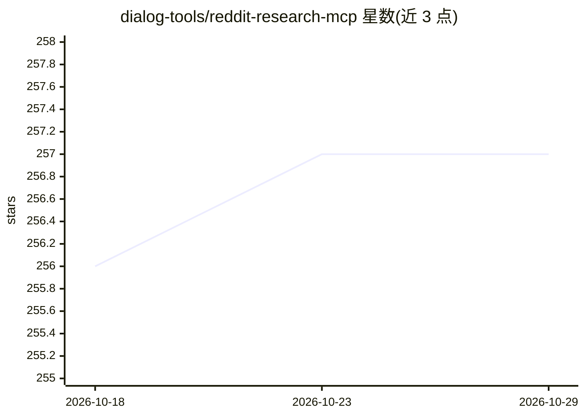

# dialog-tools/reddit-research-mcp

⭐ 257 · Python · MIT · 推送 2026-10-20 · [GitHub](https://github.com/dialog-tools/reddit-research-mcp) · [官网](https://dialog.tools/) · 组织维护

**面向 AI 助手的 Reddit 研究数据接入 MCP 服务器**

开源 MCP 服务器，为 Claude Code、Cursor、Codex CLI、Gemini CLI 等 MCP 客户端提供 Reddit 研究能力：基于向量嵌入的语义搜索覆盖 20,000+ 索引子版块（每周更新，成员 2k+），支持获取帖子与完整评论树，可将子版块集合保存为 feed 供持续监控，结果附带原帖引用（URL、点赞数等）。采用三层 MCP 架构（发现/Schema 检查/执行）与 Descope OAuth2 认证，无需 Reddit API 凭据。同时是托管平台 Dialog 研究引擎的组成部分。

## 筛选速览

| 维度 | 判定 | 备注 |
|---|---|---|
| AI 角色 | `ai-ecosystem` | LLM/agent 周边工具 |
| 许可风险 | `permissive` | MIT |
| 部署形态 | `library` | 以包/库形式分发 |
| 模型依赖 | — | README 未给出锁定关系 |
| 硬件要求 | — | 无带数字的原话,不猜 |
| 安装摩擦 | `low` | 无编译、无系统依赖或容器化 |
| 成熟度 | — | 结构信号不足 |

## 能力要点

- 语义向量搜索覆盖 20,000+ 索引子版块，突破 Reddit API 250 条结果上限
- 5 种 Reddit 操作（discover/search/fetch_posts/fetch_multiple/fetch_comments）与 5 种 feed 管理操作
- 零配置接入：无需 Reddit API 凭据，OAuth2 认证自动管理
- 每条发现附带原帖引用（URL、点赞数、奖项）

## 适用场景

- 在 Claude Code/Cursor 等 AI 助手中做竞品对比与用户情绪分析
- 产品经理跨社区收集功能需求与竞争格局信息
- SaaS 创业者验证产品想法、定位目标客户社区
- 保存 feed 对竞品社区做长期监控

## 场景标签

`语义搜索` · 领域:知识与检索

## 证据(README 行号)

> L13: Turn Reddit's chaos into evidence-backed insights. This MCP server gives any AI assistant semantic search across 20
> L15: It's fully usable on its own, for free, in Claude Code, Cursor, Codex, Gemini CLI, or any MCP-compatible client. It
> L27: ## Quick Setup (60 Seconds)

## 星数曲线

2026-10-18 256 → 2026-10-29 257（+1）

---
*卡片 v1 · prompt 1.4 · 生成 2026-10-22 · 置信度 mid · 依据 README sha `d40a25a1792a` · [字段定义](../../DATASET.md)*
