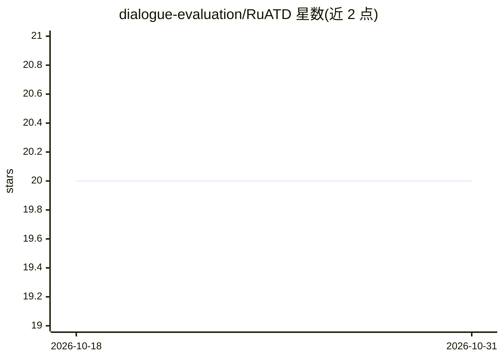

# dialogue-evaluation/RuATD

⭐ 20 · Jupyter Notebook · 推送 2025-11-17 · [GitHub](https://github.com/dialogue-evaluation/RuATD) · 组织维护

**俄语机器生成文本检测竞赛（RuATD）：提供数据集与评测任务**

Dialogue 2022 俄语人工文本检测共享任务仓库：任务为区分人写文本与神经网络生成文本，设二分类与多分类（识别具体生成模型，如 OPUS-MT、ruGPT3-Large）两种设定。数据自动标注，人写文本来自开放来源，生成文本来自机器翻译、改写、摘要、简化与无条件生成模型。评测指标为 accuracy，组织者提供 tf-idf+逻辑回归与 ruBERT 微调两个基线。竞赛已于 2022 年结束，扩展版语料以 CoAT 形式在 HuggingFace 发布。

## 筛选速览

| 维度 | 判定 | 备注 |
|---|---|---|
| AI 角色 | `ai-knowledge` | 知识聚合/清单类 |
| 许可风险 | `none` | — |
| 部署形态 | `None` |  |
| 模型依赖 | — | README 未给出锁定关系 |
| 硬件要求 | — | 无带数字的原话,不猜 |
| 安装摩擦 | `low` | 无编译、无系统依赖或容器化 |
| 成熟度 | — | 结构信号不足 |

## 能力要点

- 二分类（人写/机器生成）与多分类（识别生成模型）两种任务设定
- 覆盖机器翻译、改写、摘要、简化、无条件生成五类生成来源
- 提供 tf-idf+逻辑回归与 ruBERT 微调两个基线方案
- 扩展语料 CoAT 已在 HuggingFace 发布并附两篇论文

## 适用场景

- 研究俄语机器生成文本的检测方法
- 获取带标注的俄语人写/生成文本平行语料
- 复现或对比 RuATD 共享任务的参赛方案

## 场景标签

`模型评测` · 领域:评测与运维

## 证据(README 行号)

> L40: Соревнование RuATD (Russian Artificial Text Detection) посвящено задаче автоматического распознавания сгенерированн
> L45: С формальной точки зрения, первая задача является задачей бинарной классификации, а вторая – мультиклассовой класси
> L81: - **tf-idf** + логистическая регрессия

## 星数曲线

2026-10-18 20 → 2026-10-31 20（+0）

---
*卡片 v1 · prompt 1.4 · 生成 2026-10-28 · 置信度 high · 依据 README sha `b274504fc842` · [字段定义](../../DATASET.md)*
