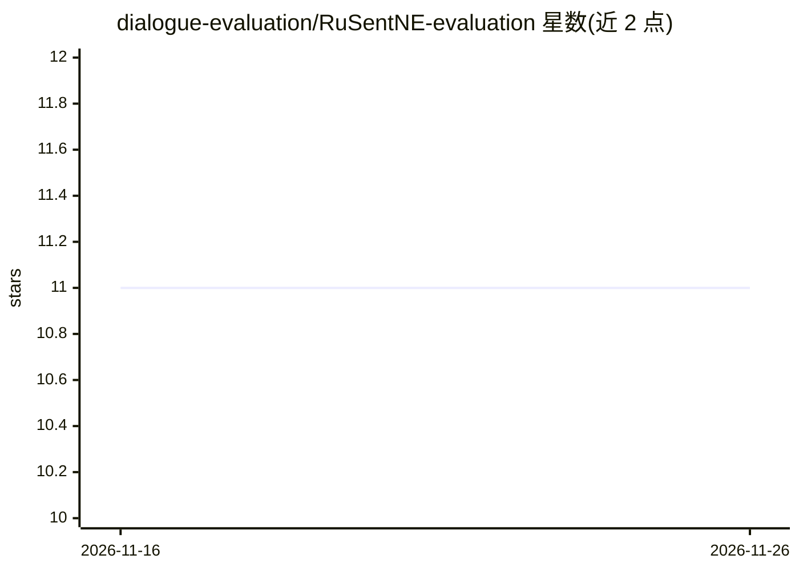

# dialogue-evaluation/RuSentNE-evaluation

⭐ 11 · Jupyter Notebook · MIT · 推送 2026-11-16 · [GitHub](https://github.com/dialogue-evaluation/RuSentNE-evaluation) · [官网](https://www.dialog-21.ru/media/5896/golubevaplusetal118.pdf) · 组织维护

**俄语新闻实体级情感分析竞赛（RuSentNE-2023）**

面向大众媒体文本的命名实体情感分析评测任务：参赛者需对新闻句子中预标注的 PERSON、ORGANIZATION、PROFESSION、COUNTRY、NATIONALITY 五类实体输出三分类情感（正面/负面/中性）。提供基线方案（基于 RuBERT 的分类器）、数据格式说明与结果排行，托管于 Codalab，2026 年迁移至 Codabench。由莫斯科国立大学与 Newcastle University 研究者组织，附 Dialogue-2023 会议论文及 arXiv 预印本（含基于指令式大模型 Chain-of-Thought 的研究）。

## 筛选速览

| 维度 | 判定 | 备注 |
|---|---|---|
| AI 角色 | `ai-knowledge` | 知识聚合/清单类 |
| 许可风险 | `permissive` | MIT |
| 部署形态 | `None` |  |
| 模型依赖 | — | README 未给出锁定关系 |
| 硬件要求 | — | 无带数字的原话,不猜 |
| 安装摩擦 | `low` | 无编译、无系统依赖或容器化 |
| 成熟度 | — | 结构信号不足 |

## 能力要点

- 对新闻文本中五类命名实体的三分类情感抽取任务
- 提供基于 RuBERT 的 baseline_submission.zip 基线方案
- 评测托管于 CodaBench/Codalab 平台，附结果排行
- 发布 arXiv 论文与 BibTeX 引用信息

## 适用场景

- 参加俄语新闻实体情感分析评测
- 获取带实体标注与情感标签的新闻数据格式规范
- 复现基于 RuBERT 或大模型的基线结果

## 场景标签

`模型评测` · 领域:评测与运维

## 证据(README 行号)

> L1: # RuSentNE-2023: Соревнование по анализу тональности к именованным сущностям в новостных текстах
> L34: Участникам предлагается задача извлечения из новостных текстов тональности трёх классов (негативная, позитивная, не
> L37: * `baseline_submission.zip` -- применение классификатора на основе модели RuBERT (см. описание применения в тексте 

## 星数曲线

2026-11-16 11 → 2026-11-26 11（+0）

---
*卡片 v1 · prompt 1.4 · 生成 2026-11-18 · 置信度 high · 依据 README sha `2ceadd9fbe67` · [字段定义](../../DATASET.md)*
