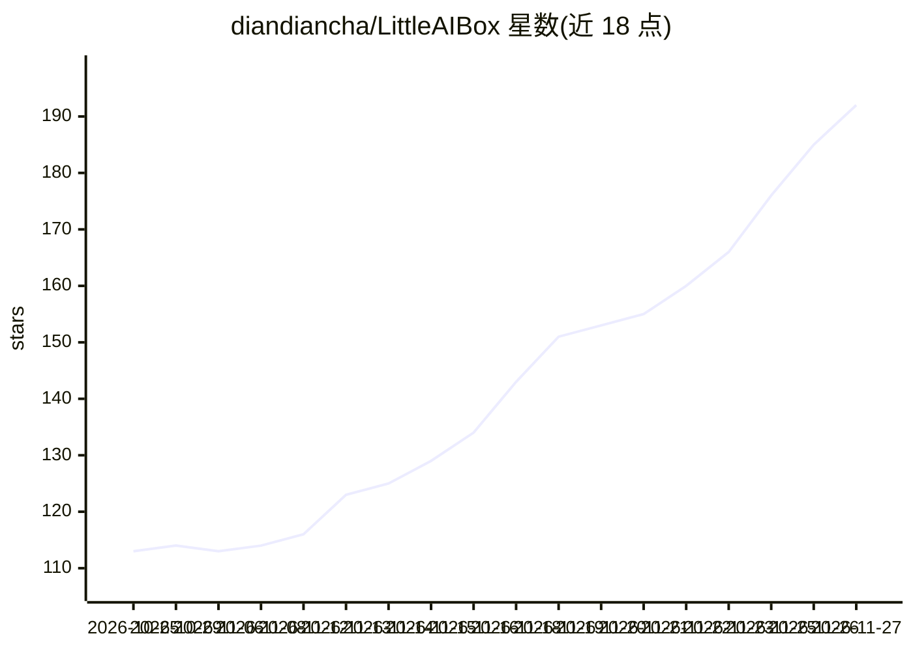

# diandiancha/LittleAIBox

⭐ 192 · JavaScript · MIT · 推送 2026-11-11 · [GitHub](https://github.com/diandiancha/LittleAIBox) · [官网](https://littleaibox.com) · 个人维护 · 中文 README

**无需注册的跨平台 AI 聊天应用：本地解析文档并调用模型对话**

基于 Vite、Capacitor 与 Cloudflare 构建的跨平台 AI 聊天应用，面向受限地区用户、学生研究者、开发者与内容创作者。前端在浏览器内解析 PDF/Office 文档、渲染 Markdown/KaTeX/Mermaid/Vega 内容，服务层负责模型接入、检索、会话与密钥轮换熔断。支持双 API key 负载均衡、实时联网搜索、Semantic Scholar 学术检索与图像生成。本仓库仅发布前端快照，后端源码与支付等商业化部分未包含，需自行配置兼容服务。

## 筛选速览

| 维度 | 判定 | 备注 |
|---|---|---|
| AI 角色 | `ai-native` | 本体是模型或模型工具 |
| 许可风险 | `permissive` | MIT |
| 部署形态 | `library` | 以包/库形式分发 |
| 模型依赖 | — | README 未给出锁定关系 |
| 硬件要求 | — | 无带数字的原话,不猜 |
| 安装摩擦 | `low` | 无编译、无系统依赖或容器化 |
| 成熟度 | — | 结构信号不足 |

## 能力要点

- 浏览器端解析 PDF/DOCX/PPTX/XLSX/CSV 等文档，本地处理内容后再发起模型请求
- 双 API key 管理：智能负载均衡或备份回退模式，含密钥统计、重试与熔断（后端维护）
- 搜索模式、研究模式（Semantic Scholar/OpenAlex 引用）与图像生成模式
- Web/PWA/Capacitor 跨平台适配，7 种语言界面与 Canvas 工作台

## 适用场景

- 在浏览器中分析论文和文档并获得带引用的回答
- 配置自己的 API key 进行私密对话，无需注册账号
- 为受限网络环境配置服务中转以连接 Gemini
- 导出含公式、图表、代码块的对话为 DOCX/PDF/PPTX/XLSX

## 场景标签

`聊天机器人` `文档问答` `文档解析` `图像生成` · 领域:对话与助手

## 证据(README 行号)

> L14: LittleAIBox combines browser-side document processing, AI request orchestration and streamed rich-content rendering
> L60: > LittleAIBox is a full-stack, cross-platform AI chat application built with Vite, Capacitor and Cloudflare. Its fr

## 星数曲线

2026-10-25 113 → 2026-11-27 192（+79）

---
*卡片 v1 · prompt 1.4 · 生成 2026-11-26 · 置信度 high · 依据 README sha `9c8c823a3136` · [字段定义](../../DATASET.md)*
