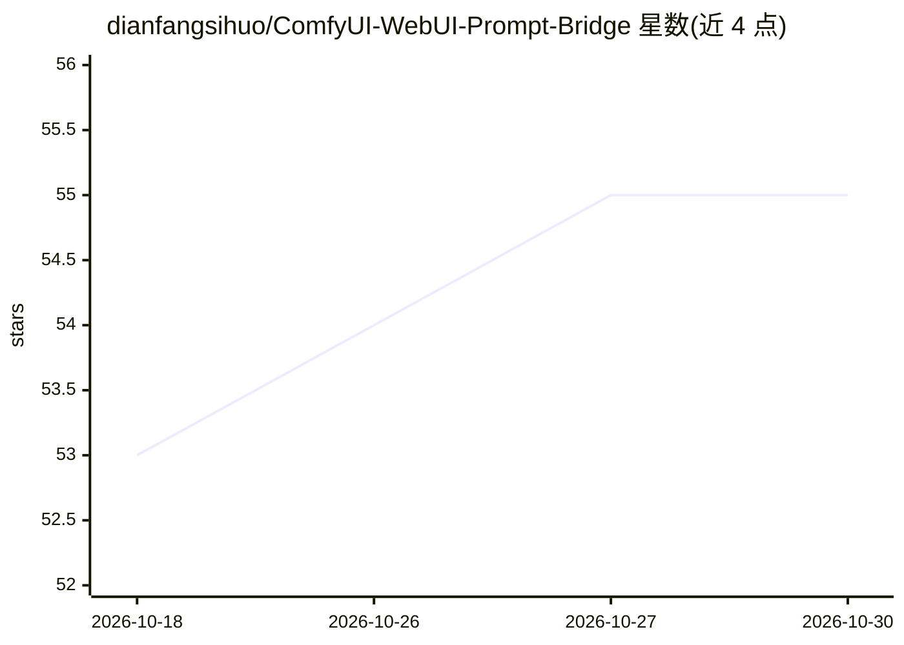

# dianfangsihuo/ComfyUI-WebUI-Prompt-Bridge

⭐ 55 · JavaScript · MIT · 推送 2026-09-20 · [GitHub](https://github.com/dianfangsihuo/ComfyUI-WebUI-Prompt-Bridge) · [官网](https://github.com/dianfangsihuo/ComfyUI-WebUI-Prompt-Bridge) · 个人维护 · 中文 README

**给 ComfyUI 的 WebUI 式提示词工作台节点：中文翻译、Tag 补全、LoRA 管理与区域控制**

ComfyUI 自定义节点，把 WebUI 风格的提示词操作搬入 ComfyUI 工作流：中文自动翻译为英文提示词、基于自带 Danbooru 数据的 Tag 自动补全、标签块编辑与排序、收藏/负面词/Styles 管理、LoRA 卡片浏览与真实加载（解析 <lora:> 后接入 model/clip 链路）、模型快速切换（Anima/Qwen 分体或整合 checkpoint）、区域提示词控制与生成参数接管；ADetailer、ControlNet、SAM 等高级模块可按需开启并一键构建外置节点。可一键接入本机 WebUI 数据。限制：仓库不含任何模型文件，需自行下载放置。

## 筛选速览

| 维度 | 判定 | 备注 |
|---|---|---|
| AI 角色 | `ai-ecosystem` | LLM/agent 周边工具 |
| 许可风险 | `permissive` | MIT |
| 部署形态 | `library` | 以包/库形式分发 |
| 模型依赖 | — | README 未给出锁定关系 |
| 硬件要求 | — | 无带数字的原话,不猜 |
| 安装摩擦 | `low` | 无编译、无系统依赖或容器化 |
| 成熟度 | — | 结构信号不足 |

## 能力要点

- 中文输入自动翻译为英文提示词，自带完整 Danbooru 主 Tag 数据与中文解释，无需联网
- 解析 <lora:name:weight> 并真实加载到 model/clip 链路，LoRA 缺失可报错停止
- 区域提示词、Styles、ADetailer、ControlNet、SAM 等模块内置或按需一键构建外置节点
- 支持 Anima/Qwen 分体模型与 SDXL/Pony 等整合 checkpoint 的快速切换

## 适用场景

- 在 ComfyUI 工作流里用中文写提示词并自动翻译补全
- 在节点内浏览和管理本地 LoRA 库并确认其真实生效
- 复用本机 WebUI 的词库、样式和收藏数据
- 从已生成图片的 metadata 读回提示词

## 场景标签

`提示工程` · 领域:Agent 开发

## 证据(README 行号)

> L7: **ComfyUI WebUI Prompt Bridge** 是一个给 ComfyUI 使用的 WebUI 式提示词工作台。它把 WebUI 里顺手的提示词输入、Tag 编辑、中文翻译、自动补全、收藏、负面词管理、LoRA 浏览/
> L14: 这个节点就是把两边的优点合到一起：**ComfyUI 负责工作流，WebUI Prompt Bridge 负责提示词、LoRA、区域控制和常用生成助手**。
> L63: - **LoRA 真实加载**：不是只把 LoRA 文本塞进 prompt，而是解析 LoRA 标签后调用 ComfyUI 的 LoRA 加载逻辑。

## 星数曲线

2026-10-18 53 → 2026-10-30 55（+2）

---
*卡片 v1 · prompt 1.4 · 生成 2026-10-24 · 置信度 mid · 依据 README sha `d35a1b06dd8f` · [字段定义](../../DATASET.md)*
