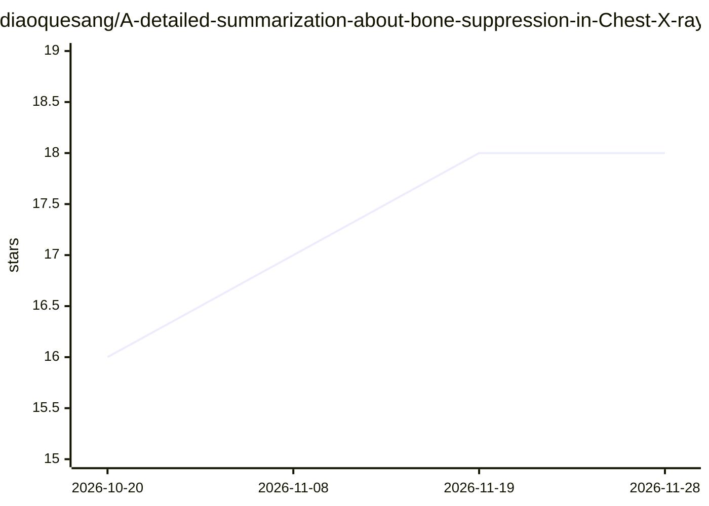

# diaoquesang/A-detailed-summarization-about-bone-suppression-in-Chest-X-rays

⭐ 18 · MIT · 推送 2026-11-04 · [GitHub](https://github.com/diaoquesang/A-detailed-summarization-about-bone-suppression-in-Chest-X-rays) · 个人维护 · 中文 README

**胸部 X 光骨抑制论文/代码/数据集综述清单**

由研究者维护的 awesome 式文献主页：收录胸部 X 光骨抑制（bone suppression）方向的代表性论文、代码与数据集，持续更新。按方法分为扩散模型、自编码器、蒸馏学习、域适应、手工抑制、GAN、卷积神经网络等类别，每条给出作者、发表会议/期刊、PDF 与部分代码/数据集（JSRT、RSNA、LIDC-IDRI 等）链接；另整理扩散模型专题与 Google Sheets 汇总表，供研究者跟踪该主题。

## 筛选速览

| 维度 | 判定 | 备注 |
|---|---|---|
| AI 角色 | `ai-knowledge` | 知识聚合/清单类 |
| 许可风险 | `permissive` | MIT |
| 部署形态 | `None` |  |
| 模型依赖 | — | README 未给出锁定关系 |
| 硬件要求 | — | 无带数字的原话,不猜 |
| 安装摩擦 | `low` | 无编译、无系统依赖或容器化 |
| 成熟度 | — | 结构信号不足 |

## 能力要点

- 按 5+1 类方法（扩散模型/GAN/CNN/自编码器/域适应/手工）组织的论文清单
- 条目附 PDF、代码与数据集（JSRT/RSNA/LIDC-IDRI 等）链接
- 提供论文要点幻灯片与 Google Sheets 汇总表
- 持续更新并接受社区贡献

## 适用场景

- 查找胸部 X 光骨抑制方向的代表论文与代码
- 跟踪扩散模型在该任务上的最新进展
- 获取 JSRT 骨抑制等公开数据集入口

## 场景标签

`精选清单` `科研工具` · 领域:学习与行业

## 证据(README 行号)

> L4: This homepage lists some representative papers/codes/datasets all about bone suppression. We aim to constantly updat
> L15: The mainstream method of bone suppression is deep learning, and can be roughly classified into **5 + 1 (manual supp

## 星数曲线

2026-10-20 16 → 2026-11-28 18（+2）

---
*卡片 v1 · prompt 1.4 · 生成 2026-11-18 · 置信度 high · 依据 README sha `c025cc7c80b6` · [字段定义](../../DATASET.md)*
