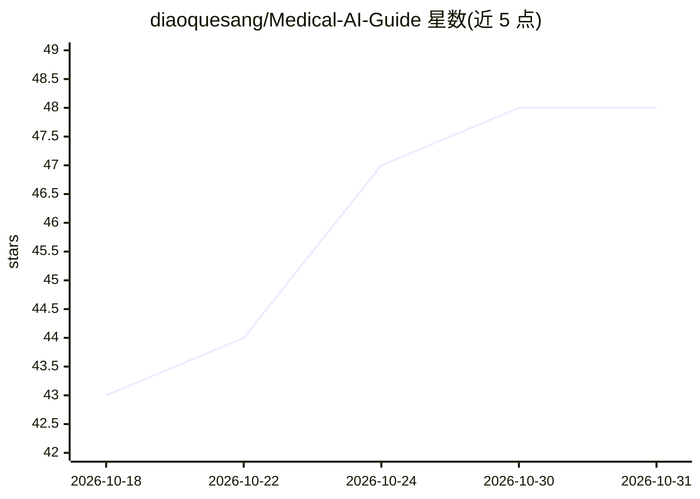

# diaoquesang/Medical-AI-Guide

⭐ 48 · MIT · 推送 2026-09-15 · [GitHub](https://github.com/diaoquesang/Medical-AI-Guide) · 个人维护 · 中文 README

**面向医学AI初学者与科研人员的系统化学习科研指南**

一个纯文档型开源指南仓库，按 14 个章节组织医学 AI 科研工作流：论文阅读方法、科研环境搭建（Linux/Python/GPU/CUDA）、编程与深度学习框架、生成式模型与基础模型（Diffusion/LLM/VLM）、医学影像任务（X-ray/CT/MRI/超声/病理）、数据集构建、评估指标与统计检验、实验设计、可复现研究规范、科学写作与 AI 辅助科研注意事项。内容以工具与主题清单形式呈现，无可安装代码，提供 bibtex 引用格式与贡献指南。

## 筛选速览

| 维度 | 判定 | 备注 |
|---|---|---|
| AI 角色 | `ai-knowledge` | 知识聚合/清单类 |
| 许可风险 | `permissive` | MIT |
| 部署形态 | `None` |  |
| 模型依赖 | — | README 未给出锁定关系 |
| 硬件要求 | — | 无带数字的原话,不猜 |
| 安装摩擦 | `medium` | 含编译或系统依赖之一 |
| 成熟度 | — | 结构信号不足 |

## 能力要点

- 覆盖从论文阅读到可复现研究发布的完整科研流程（14 章）
- 按影像模态（X-ray/CT/MRI/超声/数字病理）组织医学 AI 任务清单
- 整理分类/分割/生成等任务的评估指标与统计检验方法
- 强调可复现性：项目结构模板与环境记录清单

## 适用场景

- 医学 AI 入门者按路线图建立完整技术栈
- 科研人员查找数据集、评估指标与实验设计参考
- 搭建医学影像深度学习科研环境前了解工具选型

## 场景标签

`科研工具` `教程课程` `精选清单` · 领域:学习与行业

## 证据(README 行号)

> L22: **Medical-AI-Guide** 是一个面向医学人工智能学习者与科研人员的开源指南。
> L28: > **如何发现问题 → 理解数据 → 设计方法 → 实现模型 → 正确评估 → 撰写论文 → 发布代码 → 做出可复现的医学 AI 研究。**

## 星数曲线

2026-10-18 43 → 2026-10-31 48（+5）

---
*卡片 v1 · prompt 1.4 · 生成 2026-10-25 · 置信度 high · 依据 README sha `38896e919d1e` · [字段定义](../../DATASET.md)*
