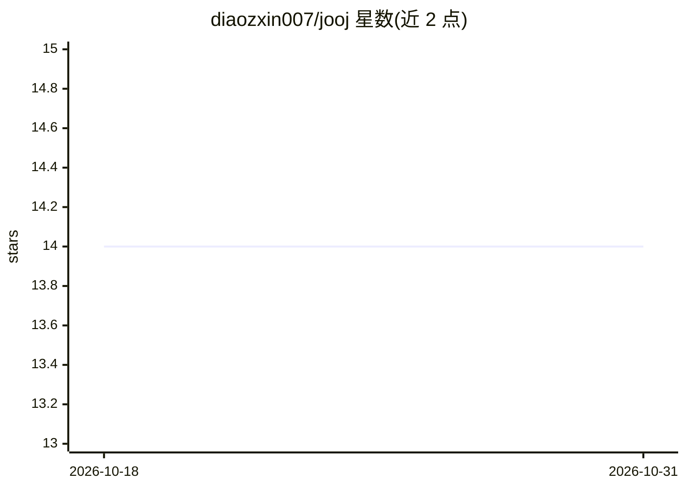

# diaozxin007/jooj

⭐ 14 · Java · WTFPL · 推送 2026-07-29 · [GitHub](https://github.com/diaozxin007/jooj) · 个人维护 · 中文 README

**Java 实现的可扩展 AI Agent 运行时，多通道接入 Claude**

用 Java 17 + Spring Boot 4 构建的 Agent 运行时框架：通过 OkHttp 直连 Anthropic 协议（无官方 SDK），提供 14 个内置工具、MCP 客户端（官方 Java SDK 2.0.0）、三层 Skills 系统、持久化记忆（SQLite FTS5）、上下文压缩流水线与两种子代理模型。同一 agent 循环经 CLI/TUI/Web/微信/cron 五种通道暴露，可嵌入 Spring 服务扩展新工具、钩子或渠道。面向想在 JVM 上学习、嵌入或扩展 agent 运行时的开发者，自带 1164 个测试。OpenAI 适配在路线图中，尚未完成。

## 筛选速览

| 维度 | 判定 | 备注 |
|---|---|---|
| AI 角色 | `ai-ecosystem` | LLM/agent 周边工具 |
| 许可风险 | `viral` | WTFPL |
| 部署形态 | `None` |  |
| 模型依赖 | locked-api |  |
| 硬件要求 | — | 无带数字的原话,不猜 |
| 安装摩擦 | `medium` | 含编译或系统依赖之一 |
| 成熟度 | — | 结构信号不足 |

## 能力要点

- OkHttp 直连 Anthropic 协议，DEBUG 级别可查看全部请求/响应
- 14 个内置工具 + MCP 客户端 + 三层 Skills 系统
- 同一 agent 循环覆盖 CLI/TUI/Web/微信/cron 五种通道
- 所有组件为 Spring @Component，加类即可扩展工具/钩子/渠道

## 适用场景

- 在 JVM/Spring 服务中嵌入可扩展的 agent 运行时
- 学习 agent 运行时内部机制（恢复、压缩、记忆、MCP）
- 通过 Web UI、终端或微信公众号多通道使用同一 agent

## 场景标签

`Agent 框架` · 领域:Agent 开发

## 证据(README 行号)

> L14: Most agent runtimes today are Python. **jooj is what happens when you build one seriously in Java** — with 1160+ te
> L29: - **You want to embed an agent inside a Spring service.** Because it *is* a Spring service. Every subsystem is a `@

## 星数曲线

2026-10-18 14 → 2026-10-31 14（+0）

---
*卡片 v1 · prompt 1.4 · 生成 2026-10-31 · 置信度 high · 依据 README sha `28398e5514ac` · [字段定义](../../DATASET.md)*
