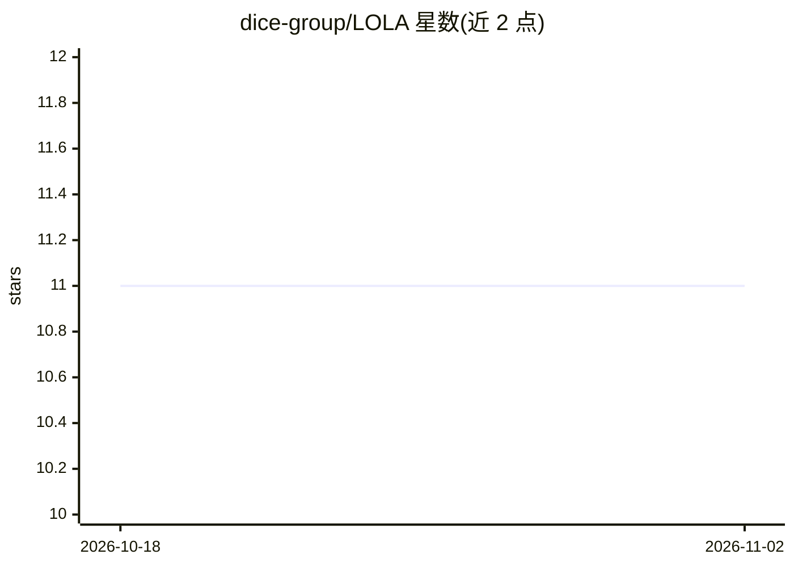

# dice-group/LOLA

⭐ 11 · Python · NOASSERTION · 推送 2026-04-08 · [GitHub](https://github.com/dice-group/LOLA) · [官网](https://huggingface.co/dice-research/lola_v1) · 组织维护

**面向160+语言的开源多语言 MoE 大模型及其训练代码**

LOLA 是基于稀疏 MoE Transformer 架构、在 160 多种语言上训练的开源大语言模型。本仓库是其训练源码，系 Megatron-DeepSpeed 的分离式 fork，提供微调（推荐 PEFT/LoRA）、MoE 路由分析、基于 CulturaX 的预训练脚本及可复用的大数据集分布式预处理实现；部分脚本针对 noctua2 等 SLURM 集群配置。模型权重开放下载，另有 HuggingFace 实现，面向科研用途。

## 筛选速览

| 维度 | 判定 | 备注 |
|---|---|---|
| AI 角色 | `ai-native` | 本体是模型或模型工具 |
| 许可风险 | `none` | NOASSERTION |
| 部署形态 | `None` |  |
| 模型依赖 | — | README 未给出锁定关系 |
| 硬件要求 | — | 无带数字的原话,不猜 |
| 安装摩擦 | `low` | 无编译、无系统依赖或容器化 |
| 成熟度 | — | 结构信号不足 |

## 能力要点

- 160+ 语言训练的稀疏 MoE Transformer 模型，权重开放下载
- 提供 PEFT/LoRA 微调脚本与自定义任务示例
- MoE 路由分析脚本与预训练脚本（CulturaX 数据准备）
- HuggingFace 实现的模型版本

## 适用场景

- 下载或微调多语言大模型用于研究
- 分析 MoE 路由行为
- 复用脚本预训练或继续训练类似模型

## 场景标签

`模型训练` `微调` · 领域:训练与推理

## 证据(README 行号)

> L3: LOLA is a massively multilingual large language model trained on more than 160 languages using a sparse Mixture-of-E
> L5: The final model weights, trained using the Deepspeed-Megatron framework, are available at: https://files.dice-resear

## 星数曲线

2026-10-18 11 → 2026-11-02 11（+0）

---
*卡片 v1 · prompt 1.4 · 生成 2026-11-02 · 置信度 high · 依据 README sha `705e74820c6f` · [字段定义](../../DATASET.md)*
