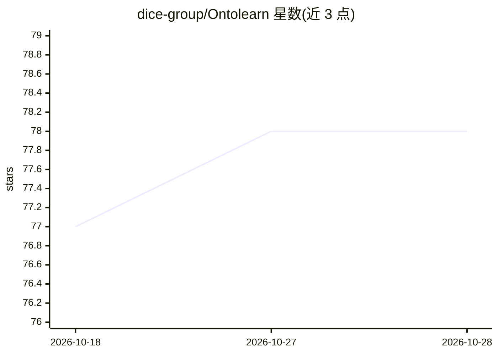

# dice-group/Ontolearn

⭐ 78 · Python · MIT · 推送 2026-10-26 · [GitHub](https://github.com/dice-group/Ontolearn) · [官网](https://ontolearn-docs-dice-group.netlify.app/index.html) · 组织维护

**从正负例中学习 OWL 类表达式的 Python 机器学习库**

面向知识图谱与本体工程研究者和开发者的开源库：给定正负 OWL 个体示例，用监督学习归纳满足覆盖正例、排除负例的 OWL 类表达式。提供 12 种学习算法，覆盖符号式、神经符号与深度学习方法（TDL、DRILL、EvoLearner、NCES2、CELOE 等）。支持从本地知识库或远程 SPARQL triplestore 加载数据，附带 HTTP/JSON webservice 可远程调用学习器，并在 Family、Mutagenesis、Carcinogenesis 基准上给出 10 折交叉验证 F1 结果。

## 筛选速览

| 维度 | 判定 | 备注 |
|---|---|---|
| AI 角色 | `ai-native` | 本体是模型或模型工具 |
| 许可风险 | `permissive` | MIT |
| 部署形态 | `library` | 以包/库形式分发 |
| 模型依赖 | — | README 未给出锁定关系 |
| 硬件要求 | `cpu-ok` | |
| 安装摩擦 | `medium` | 含编译或系统依赖之一 |
| 成熟度 | — | 结构信号不足 |

## 能力要点

- 12 种 OWL 类表达式学习算法（符号/神经符号/深度学习）
- ontolearn-webservice 暴露 HTTP/JSON API 远程运行学习器
- 支持本地 OWL 文件与远程 SPARQL triplestore 端点
- 提供 10 折交叉验证基准评测脚本与 F1 结果

## 适用场景

- 在本体上从正负例个体归纳类表达式
- 通过 webservice 远程提交学习问题并获取 DL/SPARQL 序列化结果
- 复现 Family/Mutagenesis/Carcinogenesis 基准评测

## 场景标签

`知识图谱` · 领域:知识与检索

## 证据(README 行号)

> L14: *Ontolearn* is an open-source software library for learning owl class expressions at large scale.
> L21: To address this supervised learning problem, OntoLearn provides a diverse suite of learning algorithms,
> L22: including symbolic, neuro-symbolic, and deep learning-based approaches:

## 星数曲线

2026-10-18 77 → 2026-10-28 78（+1）

---
*卡片 v1 · prompt 1.4 · 生成 2026-10-24 · 置信度 high · 依据 README sha `fa058b6c20ce` · [字段定义](../../DATASET.md)*
