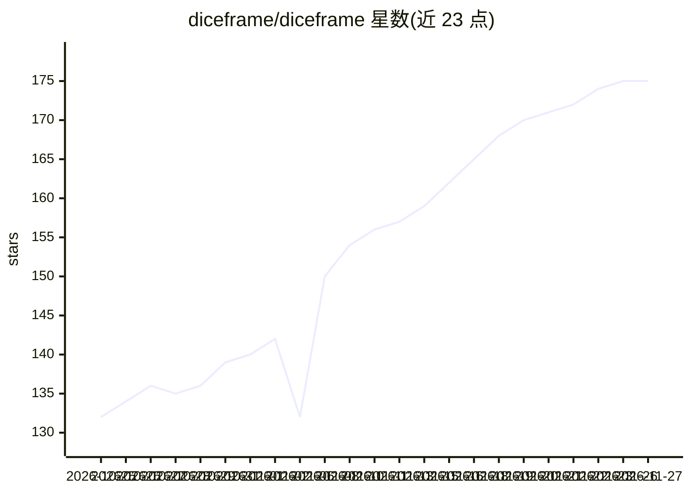

# diceframe/diceframe

⭐ 175 · Python · AGPL-3.0 · 推送 2026-11-26 · [GitHub](https://github.com/diceframe/diceframe) · [官网](https://diceframe.com) · 组织维护 · 中文 README

**可自部署的 AI 跑团引擎，支持 D&D/CoC 等规则与多人 WebUI**

DiceFrame 是一个可自部署的 AI 桌面角色扮演游戏引擎，支持 D&D、CoC 及自定义规则。玩家在浏览器中自然语言描述行动，系统执行自动骰子检定、维护角色状态，并由 GM 生成回复。支持单人或多人联机（邀请与共享游戏状态）、世界书与剧本/PDF 导入、AI 辅助创建角色卡与规则、长战役摘要记忆、文本转语音、插件与群聊 Bot，以及仅限房主操作的 DF Agent。提供 Windows 安装包/便携版、Docker 与源码三种部署方式，采用 AGPL-3.0 许可。

## 筛选速览

| 维度 | 判定 | 备注 |
|---|---|---|
| AI 角色 | `ai-native` | 本体是模型或模型工具 |
| 许可风险 | `viral` | AGPL-3.0 |
| 部署形态 | `desktop` | 安装包/桌面程序 |
| 模型依赖 | — | README 未给出锁定关系 |
| 硬件要求 | — | 无带数字的原话,不猜 |
| 安装摩擦 | `low` | 无编译、无系统依赖或容器化 |
| 成熟度 | — | 结构信号不足 |

## 能力要点

- 支持 D&D/CoC/自定义规则的自动骰子检定与状态追踪
- 多人 WebUI，支持邀请与共享游戏状态
- 世界书/剧本/PDF 导入与 AI 辅助世界、角色、规则创建
- 插件系统、群聊 Bot 与文本转语音

## 适用场景

- 和朋友在线跑 COC 或 DND 团，规则判定交给系统
- 自建服务器上托管长期战役并用摘要保留记忆
- 用 AI 辅助搭建自己的世界观和角色卡
- 在 QQ 等聊天平台通过 Bot 桥接跑团

## 场景标签

`聊天机器人` `语音合成` `文档解析` · 领域:对话与助手

## 证据(README 行号)

> L9: DiceFrame is a self-hostable **AI tabletop RPG engine** supporting **D&D / CoC / custom rules** with a **multiplayer
> L17: - Describe actions naturally; rules handle automatic dice checks and character state.
> L21: - Add plugins and chat bots; use the owner-only DF Agent for reviewed operations.

## 星数曲线

2026-10-25 132 → 2026-11-27 175（+43）

---
*卡片 v1 · prompt 1.4 · 生成 2026-11-26 · 置信度 high · 依据 README sha `9b5d13189a35` · [字段定义](../../DATASET.md)*
