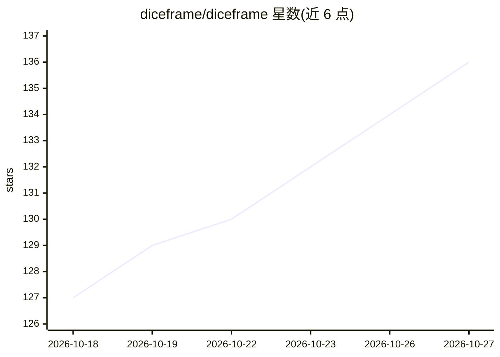

# diceframe/diceframe

⭐ 136 · Python · AGPL-3.0 · 推送 2026-10-26 · [GitHub](https://github.com/diceframe/diceframe) · [官网](https://diceframe.com) · 组织维护 · 中文 README

**自部署 AI 跑团（TRPG）引擎：多人 WebUI 跑 D&D/COC 等规则**

可自托管的 AI 桌面角色扮演游戏引擎：玩家用自然语言描述行动，系统将行动交给 GM 模型处理骰子检定与状态标签，再把结果同步回浏览器。支持 D&D 5e 风格 Lite、自定义 d20、COC 7e 风格 d100 与无骰叙事规则，提供角色卡、世界书/内容库、战役日志、单人与多人游玩（邀请链接）、QQ/NapCat 群聊 Bot、插件商店，以及可选的 TTS、嵌入记忆召回与 AI 内容生成。模型接入要求 OpenAI 兼容的 Chat Completions 端点，通过设置页配置 provider 与模型路由；旧版内联 AI 配置不再生效且无自动迁移。提供 Windows 便携版、源码运行与 Docker 部署，另有独立 Android 客户端。

## 筛选速览

| 维度 | 判定 | 备注 |
|---|---|---|
| AI 角色 | `ai-native` | 本体是模型或模型工具 |
| 许可风险 | `viral` | AGPL-3.0 |
| 部署形态 | `desktop` | 安装包/桌面程序 |
| 模型依赖 | — | README 未给出锁定关系 |
| 硬件要求 | — | 无带数字的原话,不猜 |
| 安装摩擦 | `low` | 无编译、无系统依赖或容器化 |
| 成熟度 | — | 结构信号不足 |

## 能力要点

- 多规则骰子检定层：d20/d100/无骰叙事，含优劣势、奖惩骰、HP/物品/死亡等状态处理
- 单人与多人 WebUI 游玩，含邀请链接、GM 强制推进与实验性 WebRTC 玩家直连
- AI 辅助生成世界、规则、角色与世界书；可选基于嵌入的长期会话记忆召回
- 内置 QQ/NapCat Bot 插件与社区插件商店（.dfplugin 本地安装）

## 适用场景

- 和朋友在线跑 D&D 或 COC 团，由 AI GM 主持叙事与检定
- 导入 Foundry/Fantasy Grounds 剧本来跑模组
- 通过 QQ 群聊 Bot 进行跑团对话与提问
- 自托管在 NAS 或服务器上，用手机/浏览器加入游戏

## 场景标签

 · 领域:游戏/AI 娱乐

## 证据(README 行号)

> L13: DiceFrame is a self-hostable **AI tabletop RPG engine** supporting **D&D / CoC / custom rules** with a **multiplaye
> L15: It brings the Web UI, character sheets, lorebooks, dice checks, state changes, campaign logs, and optional chat-bot

## 星数曲线

2026-10-18 127 → 2026-10-27 136（+9）

---
*卡片 v1 · prompt 1.4 · 生成 2026-10-22 · 置信度 high · 依据 README sha `bae83b3db54d` · [字段定义](../../DATASET.md)*
