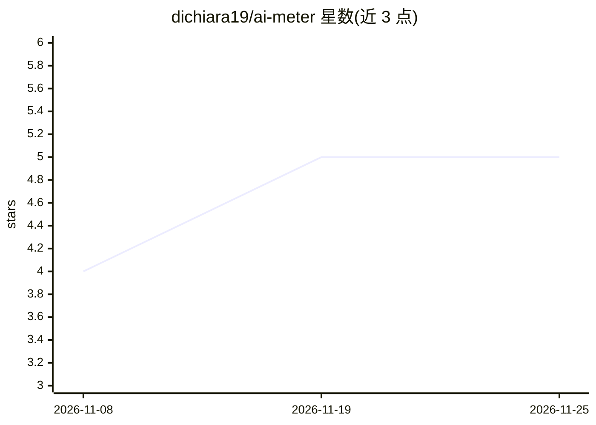

# dichiara19/ai-meter

⭐ 5 · C# · Apache-2.0 · 推送 2026-11-23 · [GitHub](https://github.com/dichiara19/ai-meter) · 个人维护

**在 Windows 11 任务栏显示各 AI 服务用量与限额的监控工具**

以任务栏内嵌 pill 形式运行的 Windows 11 桌面工具：读取 Claude、ChatGPT/Codex、GitHub Copilot、Cursor、OpenRouter 等订阅服务的用量端点，以及 Ollama、LM Studio、llama.cpp、vLLM 等本地模型服务器的显存与请求状态，提供限额预测、低额通知与本地使用历史仪表盘。数据仅存本机，无遥测，经 MCP 服务器供 AI 应用读取限额与会话。Apache 2.0，依赖 Windows 已有 .NET Framework 的 WPF，无需额外运行时。

## 筛选速览

| 维度 | 判定 | 备注 |
|---|---|---|
| AI 角色 | `ai-enhanced` | 去掉 AI 部分产品仍成立 |
| 许可风险 | `permissive` | Apache-2.0 |
| 部署形态 | `desktop` | 安装包/桌面程序 |
| 模型依赖 | local-ok | 支持本地模型 |
| 硬件要求 | — | 无带数字的原话,不猜 |
| 安装摩擦 | `low` | 无编译、无系统依赖或容器化 |
| 成熟度 | — | 结构信号不足 |

## 能力要点

- 任务栏 pill 实时显示多项订阅服务的 5 小时/周限额与用量预测
- 读取本地模型服务器（Ollama/LM Studio/llama.cpp/vLLM）的显存、上下文与请求状态
- 本地使用历史仪表盘：每日活动、配额周期、会话 token 记录与消费信号
- 内置 MCP 服务器，供 Claude Code/Codex/Cursor 等 AI 应用读取限额；Apache 2.0 无遥测

## 适用场景

- 在限额耗尽前收到通知并预测何时用完
- 统一查看 Windows 与 WSL 中编码代理及本地模型的资源占用
- 回溯查看自己各 AI 服务的使用历史与消费趋势
- 让本地 AI 应用通过 MCP 查询当前限额与空闲模型

## 场景标签

 · 领域:开发者工具/系统监控

## 证据(README 行号)

> L3: **AI limits in your taskbar. A local history of what you use.**
> L16: - **Lives in the taskbar.** The pill is part of the taskbar, not a window floating on it: it hides with an auto-hid
> L21: - **Local models are first-class.** Ollama, LM Studio, llama.cpp, llama-swap, vLLM and more: video memory, context 

## 星数曲线

2026-11-08 4 → 2026-11-25 5（+1）

---
*卡片 v1 · prompt 1.4 · 生成 2026-11-21 · 置信度 high · 依据 README sha `11461ccdf5c4` · [字段定义](../../DATASET.md)*
