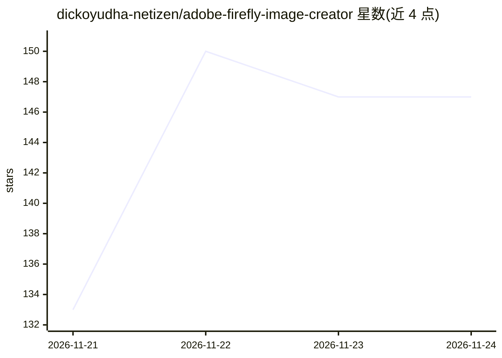

# dickoyudha-netizen/adobe-firefly-image-creator

⭐ — · [GitHub]() · 个人维护

**Web 应用：通过 Adobe Firefly 将文本提示生成图像**

一个以 Adobe Firefly 为图像生成引擎的 Web 应用：用户输入自然语言提示，选择风格/媒介预设与宽高比、构图参数，提交后生成图像预览，可请求同一提示的多个变体、对比并导出下载。提供提示历史记录与跨会话偏好保存。要求 Windows 10/11 与 PowerShell 5.1+，README 提到 PowerShell 安装设置但未给出具体安装命令或源码说明。FAQ 声明提供免费额度，并提及面向高用量用户的付费计划。

## 筛选速览

| 维度 | 判定 | 备注 |
|---|---|---|
| AI 角色 | `ai-native` | 本体是模型或模型工具 |
| 许可风险 | `permissive` | — |
| 部署形态 | `None` |  |
| 模型依赖 | — | README 未给出锁定关系 |
| 硬件要求 | — | 无带数字的原话,不猜 |
| 安装摩擦 | `low` | 无编译、无系统依赖或容器化 |
| 成熟度 | — | 结构信号不足 |

## 能力要点

- 提示词到图像生成，支持风格与媒介预设
- 宽高比与构图控制，预览随设置实时更新
- 同一提示生成多变体并排对比
- 提示历史记录与跨会话偏好保存

## 适用场景

- 为社交媒体帖子生成方形宣传图
- 为博客文章生成横版与竖版插画头图
- 复用历史提示词换风格重新生成图像

## 场景标签

`图像生成` · 领域:内容生成

## 证据(README 行号)

> L12: Adobe Firefly Image Creator turns text prompts into striking, production-ready visuals in seconds, giving teams a f
> L23: - **Prompt-to-image generation that feels instant.** Describe what you want in plain language and watch Adobe Firef
> L149: Adobe Firefly Image Creator offers a generous free tier so you can start generating images right away, with premiu

## 星数曲线

2026-11-21 133 → 2026-11-24 147（+14）

---
*卡片 v1 · prompt 1.4 · 生成 2026-11-21 · 置信度 mid · 依据 README sha `4d1368895989` · [字段定义](../../DATASET.md)*
