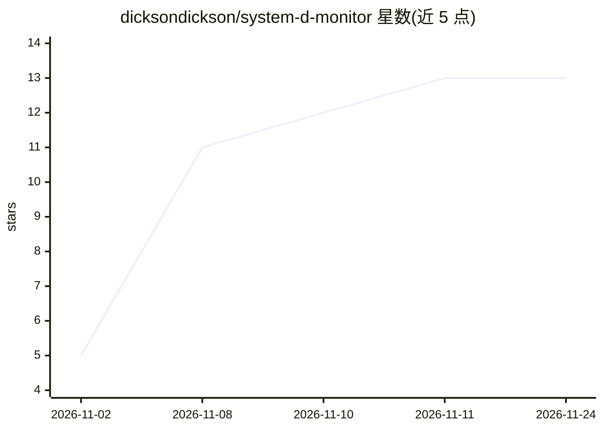

# dicksondickson/system-d-monitor

⭐ 13 · C++ · MIT · 推送 2026-11-15 · [GitHub](https://github.com/dicksondickson/system-d-monitor) · 个人维护

**ESP32-S3 触屏桌面面板：实时展示 LLM 推理服务器指标**

运行在 Guition ESP32-S3-4848S040 4 英寸触屏板上的桌面仪表盘固件，通过 Wi-Fi 每隔数秒轮询 vLLM 与 TensorFold 服务器的 /metrics 端点，自行计算并显示 decode/prefill 速度、KV 缓存、队列、流、TTFT 与投机解码接受率；支持自动识别引擎、最多 4 台服务器切换、42 套 btop 配色主题。无需在 GPU 服务器侧安装任何组件，也不依赖 Prometheus 或云服务。需 PlatformIO 构建、烧录，配置 Wi-Fi 与服务器地址后运行。

## 筛选速览

| 维度 | 判定 | 备注 |
|---|---|---|
| AI 角色 | `ai-ecosystem` | LLM/agent 周边工具 |
| 许可风险 | `permissive` | MIT |
| 部署形态 | `library` | 以包/库形式分发 |
| 模型依赖 | local-ok | 支持本地模型 |
| 硬件要求 | — | 无带数字的原话,不猜 |
| 安装摩擦 | `low` | 无编译、无系统依赖或容器化 |
| 成熟度 | — | 结构信号不足 |

## 能力要点

- 轮询引擎自身 /metrics 端点，服务器侧零安装、无 Prometheus/云依赖
- 自动识别 vLLM 与 TensorFold，最多 4 台服务器触摸切换
- 显示 decode/prefill 速率、KV 缓存、TTFT、投机解码接受率等指标
- 42 套 btop 配色主题，设置随重启保留

## 适用场景

- 在桌面上实时查看 vLLM 推理服务器的吞吐与 KV 缓存状态
- 局域网内同时监控多台 LLM 推理服务器并快速切换查看
- 排查推理服务器超时、DNS 解析、端口拒绝等连接问题

## 场景标签

`LLM 可观测性` · 领域:评测与运维

## 证据(README 行号)

> L5: SYSTEM-D is a 4″ touchscreen desk dashboard for your LLM inference servers. It shows live
> L24: - **No server-side setup.** The board polls each engine's own `/metrics`
> L27: - **vLLM and TensorFold**, detected automatically, **up to 4 servers**; tap

## 星数曲线

2026-11-02 5 → 2026-11-24 13（+8）

---
*卡片 v1 · prompt 1.4 · 生成 2026-11-18 · 置信度 high · 依据 README sha `4132e2245e20` · [字段定义](../../DATASET.md)*
