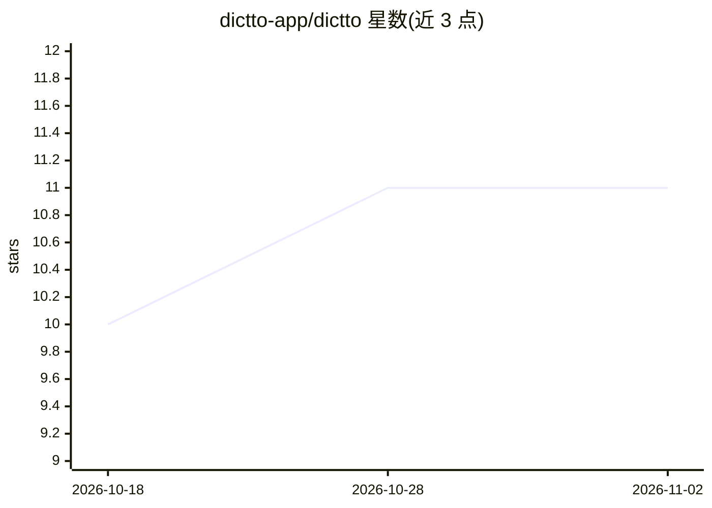

# dictto-app/dictto

⭐ 11 · Rust · AGPL-3.0 · 推送 2026-03-14 · [GitHub](https://github.com/dictto-app/dictto) · [官网](https://dictto.dev/) · 组织维护

**Windows 按键说话听写工具：松开热键即上屏整理文本**

面向 Windows 用户的按住即说（push-to-talk）语音转文字桌面应用：按住 Ctrl+Win 录音，松开后音频经用户自有 OpenAI API key 发送到 Whisper 转录，再由 GPT 去除填充词、修正语法并格式化，约 1–2 秒后粘贴到光标位置。支持 102 种语言与混合语言听写，零遥测，音频不落盘，API key 存于 Windows Credential Locker，转写历史存于本地 SQLite。基于 Tauri + Rust 构建，安装包约 5 MB，从 GitHub Releases 下载安装器或从源码构建。限制：需自备 OpenAI API key，仅支持 Windows。

## 筛选速览

| 维度 | 判定 | 备注 |
|---|---|---|
| AI 角色 | `ai-native` | 本体是模型或模型工具 |
| 许可风险 | `viral` | AGPL-3.0 |
| 部署形态 | `desktop` | 安装包/桌面程序 |
| 模型依赖 | — | README 未给出锁定关系 |
| 硬件要求 | — | 无带数字的原话,不猜 |
| 安装摩擦 | `low` | 无编译、无系统依赖或容器化 |
| 成熟度 | — | 结构信号不足 |

## 能力要点

- 按住热键录音、松开即转录上屏的 push-to-talk 模式，无常驻监听
- BYOK：音频直接从设备发送 OpenAI，无中间服务器
- GPT 清理填充词并修正语法，支持 102 种语言
- 零遥测/零账号，转写历史本地 SQLite 存储

## 适用场景

- 在任意应用文本框用语音快速输入文字
- 写作或编程时用语音口述替代打字
- 希望用自有 API key 控制听写数据流向

## 场景标签

`语音识别` · 领域:感知与多模态

## 证据(README 行号)

> L25: |**3. Release**|Let go — audio is sent to OpenAI Whisper for transcription|
> L26: |**4. Done**|AI cleans up filler words, fixes grammar, and pastes the text at your cursor|
> L104: |**Transcription**|OpenAI Whisper API (BYOK)|
> L105: |**Text cleanup**|OpenAI GPT (BYOK)|

## 星数曲线

2026-10-18 10 → 2026-11-02 11（+1）

---
*卡片 v1 · prompt 1.4 · 生成 2026-11-02 · 置信度 mid · 依据 README sha `1a80f3ee3c56` · [字段定义](../../DATASET.md)*
