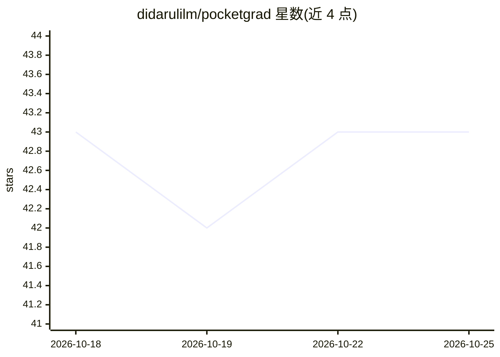

# didarulilm/pocketgrad

⭐ 43 · Jupyter Notebook · MIT · 推送 2026-07-22 · [GitHub](https://github.com/didarulilm/pocketgrad) · 个人维护

**教学用途的 Python 自动微分引擎与神经网络库**

用 Python 编写的极简 autograd 引擎，参照 micrograd 实现反向模式自动微分，每个计算图节点为 Scalar 标量，可逐步手工验证链式法则梯度。附带小型神经网络库 nn.py 与计算图可视化 visualize.py，提供训练两层 MLP 的 notebook 示例。面向理解 PyTorch 等框架底层原理的学习者；明确不支持张量化、GPU/CUDA 与生产级 API 广度。pip 可安装，MIT 许可。

## 筛选速览

| 维度 | 判定 | 备注 |
|---|---|---|
| AI 角色 | `ai-ecosystem` | LLM/agent 周边工具 |
| 许可风险 | `permissive` | MIT |
| 部署形态 | `library` | 以包/库形式分发 |
| 模型依赖 | — | README 未给出锁定关系 |
| 硬件要求 | — | 无带数字的原话,不猜 |
| 安装摩擦 | `medium` | 含编译或系统依赖之一 |
| 成熟度 | — | 结构信号不足 |

## 能力要点

- Scalar 标量计算图实现反向模式自动微分
- nn.py 神经网络库与 visualize.py 计算图可视化
- 提供 two-moons 数据集训练 MLP 的端到端 notebook
- 附带 pytest 测试套件（uv 或 python -m pytest 运行）

## 适用场景

- 从第一性原理理解反向传播与自动微分
- 手工验证每一步链式法则梯度
- 学习 PyTorch 等框架的底层实现机制

## 场景标签

`教程课程` · 领域:学习与行业

## 证据(README 行号)

> L5: A minimal, pedagogical implementation of an autograd engine and neural network library written in Python. Built to u
> L46: - **Scalar-valued by design:** Each node in the computation graph is represented as a `Scalar` rather than a tensor

## 星数曲线

2026-10-18 43 → 2026-10-25 43（+0）

---
*卡片 v1 · prompt 1.4 · 生成 2026-10-25 · 置信度 high · 依据 README sha `ff60bb7f2b4c` · [字段定义](../../DATASET.md)*
