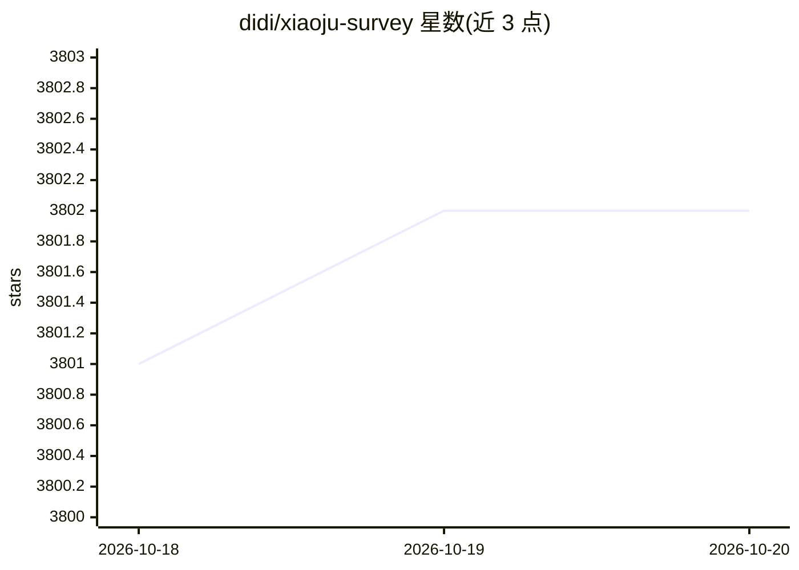

# didi/xiaoju-survey

⭐ 3,802 · TypeScript · Apache-2.0 · 推送 2026-10-16 · [GitHub](https://github.com/didi/xiaoju-survey) · [官网](https://xiaojusurvey.didi.cn) · 组织维护 · 中文 README

**滴滴开源的企业级问卷调查、考试与表单构建及数据分析平台**

面向个人和企业的开源调研系统：提供 40+ 种题型、100+ 模板，支持创建问卷、考试、测评、投票与复杂表单，具备显示/跳转逻辑编排、多角色权限协同、分题统计与交叉分析等报表能力，以及多端嵌入式问卷 SDK。AI 部分为对话式一键生成问卷（接入 LLM），是表单产品中的功能增强项。技术栈 Vue3 + NestJS + MongoDB，跨端用 React Native，提供 Docker 化部署（slim/full 镜像）与本地开发手册。

## 筛选速览

| 维度 | 判定 | 备注 |
|---|---|---|
| AI 角色 | `ai-enhanced` | 去掉 AI 部分产品仍成立 |
| 许可风险 | `permissive` | Apache-2.0 |
| 部署形态 | `library` | 以包/库形式分发 |
| 模型依赖 | — | README 未给出锁定关系 |
| 硬件要求 | — | 无带数字的原话,不猜 |
| 安装摩擦 | `low` | 无编译、无系统依赖或容器化 |
| 成熟度 | — | 结构信号不足 |

## 能力要点

- 40+ 种题型与 100+ 模板，覆盖问卷/考试/投票/测评场景
- 显示逻辑、跳转逻辑、选项引用等动态表单编排
- 分题统计、交叉分析、多渠道分析等在线报表与数据导出
- AI 对话式生成问卷，支持接入 LLM 实时预览
- 提供 slim/full 两种 Docker 镜像与部署指导手册

## 适用场景

- 企业搭建市场调研、客户满意度调研的问卷平台
- 组织在线考试、投票与测评并回收分析数据
- 通过对话快速生成问卷初稿再编辑投放

## 场景标签

 · 领域:调研/表单 SaaS 平台

## 证据(README 行号)

> L23: &ensp;&ensp;**XIAOJUSURVEY**是一套轻量、安全的调研系统，提供面向个人和企业的一站式产品级解决方案，用于构建各类问卷、考试、测评和复杂表单，快速满足各类线上调研场景。
> L39: - AI 生成问卷，支持一键接入LLM：对话式生成问卷，实时预览更快速。
> L67: 智能化问卷：AI 一句话生成问卷

## 星数曲线

2026-10-18 3,801 → 2026-10-20 3,802（+1）

---
*卡片 v1 · prompt 1.4 · 生成 2026-10-20 · 置信度 high · 依据 README sha `ed60ff2b846c` · [字段定义](../../DATASET.md)*
